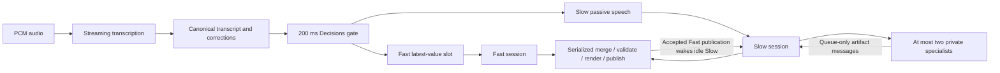

# Talkdeck orchestration

Single-slide, talk-first generation using **OpenAI only**. All implementation,
package dependencies, logs and generated test artifacts live in this directory.
The root `.env`, `test-fixture.txt` and `test-fixture.wav` are read-only inputs.

## Run

Tested with Node.js 24. See [VERIFICATION.md](VERIFICATION.md) for test evidence
and measured latency limitations.

```sh
cd orchestration
npm ci
npx playwright install chromium
npm run check
npm test
npm run fixture             # Real WAV -> live STT -> Decisions -> Fast/Slow -> slide
npm run fixture -- --text   # Optional paced text replay, not an audio integration test
npm start                  # Local HTTP/SSE API on 127.0.0.1:8787
npm run audit -- runs/<run> # Fixture content/lifecycle checks
npm run replay-publications -- runs/<run> # Recorded edits through current publisher
```

Credentials: `OPENAI_API_KEY` or `OPENAI_KEY`, from environment or `../.env`.
No key is sent to a browser or written to run logs. Fixture commands make paid API
calls. Defaults are `gpt-live-transcribe`, `gpt-6-luna` for Decisions/Fast,
`gpt-6-sol` for Slow/specialists, and `gpt-image-1` for specialist image generation.
Override with `TRANSCRIPTION_MODEL`, `DECISION_MODEL`, `FAST_MODEL`, `SLOW_MODEL`,
`SPECIALIST_MODEL`, and `IMAGE_MODEL`. `RUN_DIR` controls fixture output;
`REPLAY_SPEED=1` is real-time playback, higher values are accelerated stress tests.
Fast requests no reasoning effort; Slow/specialists request low effort. Model
requests have bounded network retries. The fixture verifies API connectivity
before sending audio and reports failure if its final transcript cannot be evaluated.

## Architecture



### Dispatch

The clock ticks every 200 ms, independent of speech arrivals and silence. With
undispatched text, it calls the native Decisions endpoint with a dispatch/hold
choice. Dispatch permits reasoning, not mandatory mutation. Hold retains speech.

Up to eight decision calls may overlap; occupied-capacity ticks are skipped, not
queued. Each call has a 30-second deadline. Errors retain text and use bounded
backoff. These are explicit overload policies; the service does not promise
200 ms API latency or a request start on every tick under overload.

Each decision evaluates an immutable snapshot. Its result is discarded if its
last-dispatch baseline changed or newer recognition corrections invalidated its
wording. Accepted dispatches send that evaluated snapshot; later append-only
speech stays pending for the next tick. Each busy agent has one replaceable
speech value containing the whole transcript and accumulated correction context.

### Agent sessions

Each actor preserves conversation/tool history; only one inference runs in an
actor at once. Different actors may infer concurrently. Before each model call,
arrived messages/tasks/speech, statuses and the current observation are supplied.
Running inference input is never mutated. Latest two distinct observations
include actual PNG image inputs and source; older observation bodies remain in
logs and become references in projected model history.

Fast handles routine additions and initial composition. Slow refines semantics,
hierarchy and visual explanation. Neither owns a slide region. Passive speech is
labelled as already sent to Fast and never wakes or forces continuation of Slow.
Accepted state-changing Fast publications wake idle Slow. Active Slow gets no
publication mailbox broadcast. At completion, its last supplied observation's
Fast watermark is compared with current publication state, coalescing unseen
Fast publications into one follow-up. Slow publications never wake it.

Slow can delegate, message, follow up and wait. Specialists create immutable
private artifacts (SVG, component HTML/CSS, text or generated image). Only Slow
integrates those artifacts. Two active specialists are allowed. Completion queues
information; a waiting parent resumes its existing activation. `send_message`
never wakes idle recipients; `followup_task` requests work without duplicating
active turns. Required outstanding specialist tasks prevent Slow from finishing.
Their completion must reach a model boundary before Slow can finish, including
when the child finishes during a running inference. A failed specialist remains
visible in status, but does not fail settlement after Slow observes the failure
and finishes successfully.

The 64-step safety budget bounds work without fresh input. Dispatched Fast speech,
new Fast publications observed by Slow, explicit tasks and required specialist
completions renew it, so continuous narration does not exhaust an activation's
budget. Passive speech alone still cannot keep Slow running.

### Editing and publication

`view_slide()` and `edit({ old, new })` return the actual current observation.
`old` must match exactly once in the inference's supplied source; insertion
expands a fragment, and empty `new` deletes. Multiple edits use that inference's
original private source plus its preceding successful changes, never unseen
concurrent edits. Agents supply no versions or dependency declarations.

Publication serializes exact replacement, conservative three-way merge,
validation, Chromium rendering and state swap. Disjoint/identical changes merge;
ambiguous targets/incompatible overlaps fail. Validation/render failure leaves
source and screenshot unchanged. Every accepted state-changing edit creates one
undo unit; no-ops create none. Stale Fast merge conflicts forward intent and
supporting speech to Slow once. Neither side gets automatic precedence or retry.

Chromium checks execution errors, duplicate IDs per document/shadow scope,
unregistered custom elements, missing fragment/image references and external
asset requests. Registered assets are content-addressed and copied on read/write.
Geometry and off-slide overflow are returned; visual diagnostics are advisory.
Static rendering freezes page time and disables CSS animations/transitions to
avoid number tweening. Successful rendering does not prove factual accuracy.

User pause/undo interactions with in-flight work, multi-slide routing,
push-to-edit, pointer grounding, feedback approval, practice/presentation modes,
and speaker-note attribution remain outside the supplied specification. There is
no AI speech output and no automatic slide advancement.

## HTTP API

The API binds to localhost. Use the exported `SlideRuntime` directly for embedded
integration; `interfaces.ts` exports the public module types.

| Method | Path                         | Contract                                                                           |
| ------ | ---------------------------- | ---------------------------------------------------------------------------------- |
| POST   | `/sessions`                  | JSON `{context?, initialSource?}`; creates one slide runtime                       |
| GET    | `/sessions/:id`              | Statuses and current observation ID                                                |
| POST   | `/sessions/:id/transcript`   | JSON `{text, revision}`; increasing full-text snapshots                            |
| POST   | `/sessions/:id/audio`        | Raw mono 24 kHz PCM16; increasing `X-Audio-Sequence`, starting at 1; send serially |
| POST   | `/sessions/:id/audio/commit` | End audio turn; wait for final transcript                                          |
| GET    | `/sessions/:id/events`       | SSE; reconnect with `Last-Event-ID` for event replay                               |
| GET    | `/sessions/:id/screenshot`   | Current published PNG, never a partial candidate                                   |
| GET    | `/sessions/:id/slide`        | Sandboxed current HTML document                                                    |
| GET    | `/sessions/:id/assets/:hash` | Immutable asset content                                                            |
| DELETE | `/sessions/:id`              | Cancel work and close browser/transcription connections                            |

A session uses either audio or direct transcript input, not both. No frontend
files have been changed. A deployment needs its own authentication and session
retention policy; this is a local single-process runtime, not a durable cluster.

## Verification and observability

`npm test` uses deferred fake model responses to exercise actual races, plus
real Chromium validation and the prepared WAV format. Live fixture runs save:

- `transcript.txt`, the actual transcription (audio mode).
- `events.jsonl`, decisions, exact inference inputs, tool results and publication logs.
- Immutable observation HTML/PNG files.
- `final.html`, `final.png` and `summary.json`.

The tests cover speech replacement, stale decisions, overlapping decision calls,
recognition corrections, session serialization, passive Slow context, coalesced
wakeups, queue-only mail, waiting specialists, specialist concurrency, exact-match
editing, merge conflicts, rollback, immutable assets and image-history projection.
Run logs and screenshots support the end-to-end audit; the unit tests alone do
not establish visual or semantic quality of a generated presentation.

## Documentation used

- [OpenAI Decisions](https://developers.openai.com/api/docs/guides/decisions)
- [Responses function calling](https://developers.openai.com/api/docs/guides/function-calling)
- [Realtime transcription](https://developers.openai.com/api/docs/guides/realtime-transcription)
- [Node SDK response-history normalization](https://github.com/openai/openai-node/blob/main/docs/responses.md)

Exact dependency versions are recorded in `package-lock.json`. No Vercel SDK or
Codex coding-agent harness is used for the main runtime.
