# Integrated app, first iteration

Status: implementation plan, not implemented or qualified. Prepared 2026-10-31 against backend `6a77173`; updated for upstream `12ebadb` / frontend `200ba8d`.
User request: integrate the full slide-generation flow, Present, and Practice; show original and proposed slides
side-by-side with changes highlighted inside the slides, similar to Git diff.

This plan supplements the [subsystem milestones](../IMPLEMENTATION_PLAN.md). It preserves
[SPEC](../SPEC.md), [settled decisions](DECISIONS.md), [Lucide rules](LUCIDE_ICONS.md), and the implemented
[practice proposal lifecycle](PRACTICE-REVIEW.md). It does not reopen those choices.
Only this plan and its documentation index are changed now. Implementation tasks below span `frontend/` and
`slide-generation/` and must be assigned to their respective owners; this document does not expand a worker's file scope.

## Outcome and first-release boundary

A user can create a project, speak to generate multiple canonical slides, see validated changes appear live, present
that deck, rehearse without mutating it, and review actual proposed edits before accepting them. Acceptance updates the
same deck and is undoable. All three modes use the same renderer, slide IDs, facts, notes and revision history.

Recommended first-release scope: one desktop user, one local backend process, and a same-origin browser application.
Use localhost development and a same-origin packaged deployment; public multi-user hosting/authentication is a separate
release gate, not something the current local APIs provide. Existing projects remain available; do not silently convert
or overwrite local decks. This scope is a planning assumption, not a newly settled product decision.

Keep the current flat project list, neutral dark shadcn shell, permanently visible editor sidebar and slide-focused
navigation. Preserve workspace v3; do not reintroduce folders, removed settings buttons or a sidebar toggle. Keep project context, annotations, microphone
controls, thumbnails, presenter notes, and review decisions where they work. Phone pairing, BYOK UI, companion/pet,
live coaching and automatic asset procurement remain deferred. Asset/font integration stays provisional. Manual visual
editing stays out of the active UI; explicit requested changes use the canonical service.

Existing PDF/PPTX export must never export stale local Slide objects for an integrated deck. Support PDF from canonical
rendered slides in this iteration; disable PPTX for canonical decks with an explanation until a faithful export path is
available. Legacy decks may retain their existing export behavior. This prevents a visible feature from returning the
wrong deck while keeping editable PPTX outside the critical integration path.

## Current implementation: reuse versus missing work

| Area | Already implemented | Integration work |
|---|---|---|
| Frontend shell | Flat projects, Talk, Practice, Present, review panes, annotations, storage and exports | Async canonical project/session adapters; remove local mutation paths for integrated projects |
| Generation | Real Fast/Slow scheduler, design skill, durable utterances, canonical JSX transactions and browser validation | Product HTTP/input/event transport; shared host composition and live browser publication |
| Viewer | Backend-owned 1920×1080 viewer, sandbox bridge, motion/build messages and paint acknowledgments | Product mounting, session reconnect, per-surface controls and build acknowledgment tracking |
| Practice | Recording, frozen context, one end-review model call, validated private proposals and previews | Frontend recording flow, asynchronous review/proposal controls and canonical rendering |
| Acceptance | Exact preview version, stale handling, private restaging, accepted digest checks and undo | UI must respect every outcome; no optimistic local source mutation |
| Visual diff | Source changes, before/after slide order, HTML/CSS/JPEG previews | Deterministic semantic/geometry/style diff metadata and in-slide highlight overlays |
| Speech | Desktop capture lifecycle, legacy streaming transcription, practice PCM/batch transcription | PCM adapter, stable final-utterance/correction routing, shared clocks and durable acknowledgments |

Important code boundaries:

- `src/practice/runtime.ts` already composes the canonical engine, `JsxBackend`, actors and `PracticeService`.
  It lacks the product `GenerationSession` publication transport and selection bridge.
- `src/headless/evaluation-host.ts` demonstrates durable input, routing, actual actors and viewer recording. Extract the
  necessary host services; do not embed evaluation fixtures, aliases, assertions or the timed driver in the product.
- `src/orchestration/server.ts` is a legacy HTML server. Do not expose it as the canonical app backend. Its cumulative
  `receiveTranscript` path is not the canonical input contract. Reuse transcription transport through a new adapter.
- `frontend/src/features/Review.tsx` already has Before/After panes, but its proposals are local heuristic objects.
  `SlideView` marks local fields; it does not understand canonical JSX, shared definitions or native node geometry.
- `configureFrontendAdapters` currently offers synchronous interpretation. It is insufficient for network generation,
  mode transitions, proposal jobs and authoritative commit acknowledgments.

## Architecture and authority

```mermaid
flowchart LR
  UI[React workspace and mode controls] --> API[Same-origin product API]
  Mic[Desktop microphone] --> PCM[PCM capture and acknowledged upload]
  PCM --> API
  API --> Host[One project runtime and mode coordinator]
  Host --> ASR[Speech transcription and stable utterances]
  ASR --> Input[Durable input and routing]
  Input --> Actors[Fast / Slow with design skill]
  Actors --> Engine[Canonical JSX engine]
  Host --> Practice[Practice recording and review]
  Practice --> Fork[Private validated proposals and visual diffs]
  Fork --> Review[Before / After review UI]
  Review --> Accept[Versioned acceptance]
  Accept --> Engine
  Engine --> Publish[Validated publications]
  Publish --> Viewer[Editor and audience viewers]
  Viewer --> Ack[Applied / painted / settled acknowledgments]
  Ack --> Host
```

One runtime owns each canonical project directory. Talking, presenting and practicing never start a second owner.
Project/deck identity is durable; an open browser session is an attachment to that project. Reloading reattaches to
persisted source and practice records. Existing in-memory undo history is explicitly unavailable after server restart;
do not advertise persistent undo before implementing it.

Frontend state stores project metadata, selected IDs, upload buffers and server projections. It does not maintain an
editable copy of canonical `Slide[]`. Keep legacy projects in an explicitly separate path. New integrated projects get
a schema discriminator and backend project ID. Import of old decks is explicit, reversible and separately tested;
unsupported content stays in the original project rather than being silently approximated.

Extract one shared generation-instruction builder: the evaluation host currently includes `AGENT_PROMPT.md` plus SPEC,
whereas the practice runtime loads the base prompt plus design skill. Product and future headless trials must use the
same versioned prompt configuration, with recorded snapshots for replay. Historical freezes remain unchanged.

## Modes and input behavior

| Mode | Narration | Explicit actions | Publication |
|---|---|---|---|
| View | No capture | Select, Add, canonical Undo/Redo, enter a mode | Latest validated editor surface |
| Talk | Finalized speech is durably retained and routed into generation | New/select slide, pause agents, pause/mute capture, explicit requested edit | Live editor publications; status distinguishes received, committed and painted |
| Present | Capture/transcript and recognized explicit navigation only; no generative edits | Next/Previous/build, blackout, fullscreen, End | A validated presentation revision; no late drafting activation may change it |
| Practice | Rehearsal evidence only; never sent to generation Decisions/Fast/Slow | Navigation and separately identified explicit edit commands | Record selected revision; viewer paint evidence remains a separate fact |
| Review | Recording is sealed | Accept, Reject, Refresh, request another version, Undo accepted change | Private before/after previews until exact-version acceptance |

Preserve the latest frontend's listening behavior on entering/reloading Talk, Practice and Present, subject to browser
permission and a completed backend mode/session handshake. Do not start forwarding into an unconfirmed mode.
Practice/Present show only the current session transcript; saved history remains retained. Present must preserve the
speech controls without treating narration as edits.
Do not introduce inferred slide navigation from arbitrary speech in this release. Explicit next/back commands and manual
controls are sufficient. A final Next in Present must not create a new slide. Snapshot the ready presentation revision
on entry, stop crossing generation work at a control boundary, and require an explicit return to Talk to regenerate.
Presenter notes edits, if retained in the reference UI, use the canonical notes service; they cannot modify raw evidence.

Practice's existing explicit push-to-edit action is a live canonical command and remains separately labeled as such.
The Review “Request change” action is a counter-prompt against a proposal and generates a new private preview. Never
make a request for another preview apply edits. Starting a new request without an existing proposal requires a small
backend extension that prepares one private proposal against the current deck; it must reuse the same validation and
acceptance path. Support this on any reviewed slide, including when the initial reviewer suggested no changes.

Use desktop microphone PCM as the proposed primary integrated input: mono 24 kHz PCM16, with explicit capture epochs,
chunk sequences and slide bindings. Reuse the current capture lifecycle and streaming transcriber; add AudioWorklet
conversion/resampling. Browser SpeechRecognition may remain an explicitly selected compatibility adapter, supplying
receipt-timed transcript spans. Do not run two authoritative recognizers or silently switch input methods.

For Practice audio mode, retain PCM and run the existing end-pass ASR before review. Live captions, if added, are
provisional and cannot become a second canonical rehearsal transcript. Transcript-only practice remains a supported
explicit alternative. Recording pauses stop forwarding new capture and record gaps; backend pause markers alone do not
stop microphone delivery. Finish drains and acknowledges pending chunks before sealing the recording.

O04 (follow-up focus after an offscreen named edit) is still pending. Keep existing behavior, visibly identify the
current target, and use explicit slide IDs for UI edit requests. Do not resolve that policy implicitly during integration.

## Product transport contract — proposed, not currently shipped

Implement a small versioned facade under `/api/projects/:projectId`. Reuse existing practice handlers/service methods;
new route names below describe the planned facade, not endpoints that can be called today.

| Capability | Planned contract | Required semantics |
|---|---|---|
| Projects | Create/list/open project and fetch state | Stable project/deck identity; one runtime owner; no provider key in browser |
| Attachment | Create/close session; fetch snapshot | Protocol version, mode epoch, revision, selection, actor states and capabilities |
| Input | Audio chunks/commit or finalized utterances | Stable request/utterance IDs, clock/slide binding, durable receipt, duplicate-safe retry |
| Controls | Add/select/next, pause/resume, undo/redo, mode transition | Command ID and expected control epoch; serialize state changes and reject stale commands |
| Events | SSE with sequence/event ID and `Last-Event-ID` | Commit/selection/status/publication/review events; gap detection and snapshot resync |
| Viewer | Bootstrap, artifact retrieval, acknowledgment and build controls | Per-surface unpredictable channel; versioned publication; measured clock mapping |
| Practice | Scope existing recording/review/proposal endpoints to project | Preserve the existing states, timestamps, immutable context and acceptance semantics |
| Requested preview | New private change request or existing proposal `revise` | Async job, exact target/base revision, no live mutation; one replacement proposal |
| PDF | Canonical revision export | Same rendered source as the deck; report unsupported export instead of using local slides |

Separate high-volume artifacts from small status events. Use immutable content-addressed render/image references and
bounded queues; hydrate publication payloads before calling the viewer bridge. Authorize artifact access against the
project/session if hosted. Audience attachments receive only public render/build/blackout state, never source, notes,
transcripts, review payloads or provider credentials. Local same-origin hosting still enforces channel and origin checks.

On reconnect: stop treating capture as live, retain bounded unsent data, fetch authoritative state, negotiate the new
mode epoch, and resume only if the current capture intent remains valid (never undo a user pause/mute). A reload follows
the latest explicit mode-entry behavior described above after the handshake. Re-submit the same durable input IDs, never recreate them. Acknowledged inputs must
not be delivered twice. If buffers overflow, stop capture and surface the failure; do not discard words silently.
Persist command results for idempotency where a retry could duplicate a mutation. A disconnected viewer must not block
canonical work forever; reconnect sends a fresh current snapshot and surface-specific sequence.

Use the existing environment-only credentials and shell sourcing. Responses use Fast tier; keep documented endpoint
exceptions for Decisions and transcription explicit. Share bounded provider accounting across generation and review,
record actual usage, and surface budget errors with retained work. No hidden fallback model or automatic paid retry.

## Visual diff: the required review experience

Desktop layout: affected-slide navigation, then equal **Before** and **After** panes at the same scale, with linked
zoom/pan. Use the existing red/green review styling. Below: a short change explanation, supporting rehearsal excerpt,
and Accept / Reject / Request change. Do not add a raw JSX/Git patch panel to the normal user flow.

Default previews are the exact prepared static 1920×1080 slide images, with a separate DOM/SVG overlay aligned to the
canvas. This keeps typography/layout identical to the preview that will be accepted and avoids reading across an
opaque iframe. The live app/presenter continues using the packaged viewer. Overlays are review-only; never write them
into canonical JSX, renderer HTML, exported slides or audience publications. Show all builds in static review previews;
review does not prove animation behavior. A toggle hides highlights for a clean design comparison.

On narrow screens provide a Before/After switch with the same zoom and selected change, plus an optional stacked view.
Desktop side-by-side is the primary acceptance target. Provide a textual change list and next/previous-change keyboard
controls; color is supplemented by +/−/changed/moved labels and patterns. Focus the corresponding regions in both panes.

| Change | Before highlight | After highlight |
|---|---|---|
| Insert | None; matching location indicator if useful | Green added region/text span |
| Delete | Red removed region/text span | None; explicit removed-item marker in change list |
| Text/number replacement | Red removed words/value only | Green replacement words/value only |
| Move/reparent/resize | Dashed outline at old bounds with linked change ID | Outline at new bounds with the same ID; label moved/resized |
| Font/color/fill/icon/asset | Outline old affected visual and identify property | Outline new visual; changed badge without recoloring the slide itself |
| Shared theme/definition | List every affected slide, highlight actual effects | Corresponding effects, grouped as one atomic proposal |
| Added/deleted slide | “Slide did not exist” or full removed slide | Full added slide or “Slide removed” |
| Order only | Old position badge | New position badge; do not tint unchanged slide content |
| Build/reveal only | Old group/order label | New group/order label; static images do not prove motion |
| Notes only | Notes excerpt marked removed | Notes excerpt marked added; say slide appearance is unchanged |

Backend extension: persist a versioned `visualDiff` per affected slide with `proposalVersion`, base/candidate source
and render digests, dependency inventory, diff algorithm version, canvas size, change IDs, kinds, stable origin IDs,
old/new rectangles, changed properties and optional text-range rectangles. A diff may have multiple kinds on one node.
Include frame changes, Stat labels/values, Quote attribution, bullet content, icons and resolved assets.

Build the diff deterministically from the before/after parsed and expanded source plus effective rendered properties.
Match retained authored/expanded identities, not text similarity or array index. Shared definitions require instance
identity and origin provenance. For replaced identities, report remove/add unless provenance establishes a pairing;
never invent a semantic move. Ignore system versions, generated bookkeeping and invisible metadata when classifying
visual changes, while separately reporting notes/order changes.

For word-level highlights, compare stable content parts and measure changed text ranges using DOM Range after fonts
resolve. Add stable content-part keys and text-offset mappings: current text-run ordinals are not sufficient across
inline bold/italic edits, Stat subparts or Quote attribution. Handle wrapping and Unicode without changing the DOM's
layout. Record rectangles in slide coordinates, then use the same contain/letterbox transform as the displayed image.
Layout effects on unchanged descendants are marked moved/reflowed, not as invented text replacements.
Use a documented geometry tolerance and deterministic rounding; exclude timestamps from diff signatures. Verify
reconstruction from stored artifacts after restart, including changed dependencies, rather than trusting current assets.

Capture preview images and geometry from the same immutable render artifact and browser preparation. Existing
`browser.inspect(artifact)` offers geometry, but validation currently discards it and separate screenshot calls render
again; add a review capture API instead of assuming those outputs align. Measurement failures must be explicit. If
fine-grained ranges are unavailable, show a labeled whole-element highlight; if comparison identity/artifacts are
unverifiable, disable acceptance until refreshed. Never show no changes as a fallback for missing diff evidence.

Bind the full diff/image/geometry bundle to the prepared proposal version and signature. Refresh must replace both
panes and highlights together. Accept sends the viewed version; a stale response or changed restaged preview requires
another explicit acceptance. Request-change results do not replace the current proposal until the replacement is ready.
Even if the source revision is unchanged, recheck the prepared render/dependency fingerprint before acceptance. The
current same-source fast path is not proof that fonts/assets/renderer bytes match. Changed dependencies require fresh
images/diffs and explicit acceptance; the source candidate digest alone is insufficient.
No optimistic “Applied” label before the canonical acceptance receipt. Reject leaves canonical source unchanged.

## Delivery milestones and acceptance gates

Each milestone is reviewable independently and is not complete merely because foundation tests pass.

### M0 — contract and project/session spine

- Publish shared transport types, project identity/storage schema, mode state machine, and error/receipt semantics.
- Compose one product runtime from the existing canonical runtime, actors, practice service, input controller and
  publication sessions. Extract shared code without changing frozen historical generators.
- Add environment checks, bounded provider accounting and same-origin frontend development proxy.
- **Gate:** create/open/reload two projects with isolation; attach/detach does not duplicate owners or lose source;
  wrong project/epoch commands fail; restart preserves source/reviews and accurately reports lost undo availability.

### M1 — one complete Talk vertical slice

- Replace local interpretation/mutation for integrated projects with async input and event adapters.
- Mount the canonical viewer; implement durable typed utterance input first as a transport test, then real desktop PCM
  capture/transcription through exactly the same retained-utterance route. Wire project brief and source context.
  Preserve uploaded material bytes and parsing status; pass only supported extracted context with provenance. Reference-only
  files remain labeled as such. Upload acceptance never means the model understood the file or that an asset resolved.
- Add transcript state, slide thumbnails, navigation, Add and canonical Undo/Redo. Only final input drives generation;
  retain explicit corrections with their original IDs and attribution.
- **Gate:** real speech creates three distinct slides, a correction reaches the right slide, and the final visible
  text/qualifier is verified in Chromium. Reload retains the deck. Late speech after navigation stays with its original
  slide. Paused/stopped/old-session callbacks cannot mutate source. Retrying a receipt creates no duplicate input/edit.
- **Evidence:** actual model calls/tiers/usage, raw receipts, commits, paint/settled timestamps, individual screenshots
  and one whole-deck contact sheet. A successful API response without visible content does not pass.

### M2 — Present and audience isolation

- Gate entry on complete whole-deck readiness for the presented revision. Display actionable failure/Pending details.
- Implement a presentation control boundary, per-surface bootstrap, source/selection synchronization, presenter notes,
  next preview, explicit next/previous, reveal/back build, blackout/restore and fullscreen.
- Extend `GenerationSession` for build sequencing and acknowledgment validation: it currently emits build zero and
  assumes acknowledgment sequence equals the original publication. Viewer protocol support alone is insufficient.
- **Gate:** keyboard/manual/explicit speech navigation works without generating slides; build order and reserved space
  are correct; paused or old actors cannot publish into Present; audience sees no private data; reconnect restores the
  right slide/build/blackout; resource or readiness failure keeps the last valid surface with a clear presenter error.

### M3 — Practice recording and real end-review

- Replace local `buildRehearsal` with the canonical PracticeService flow. Start awaits its control boundary; recording
  speech is never passed to generation. Bind audio, navigation and source revisions to a shared measured clock.
- Finish flushes capture receipts, seals once, shows processing, then loads actual feedback and prepared proposals.
  Wire failure/retry/cancel and persisted review reopening. No fabricated delivery/tone feedback.
- Add the private request-change entry point for slides without proposals; reuse revise for existing proposals.
- **Gate:** rehearsing “delete this slide” leaves canonical source unchanged; explicit live edit is separately recorded;
  finish produces real review previews without applying them; replayed/late finish cannot create a second job; cancelled
  results cannot replace current review; failed review can retry retained evidence without another rehearsal.

### M4 — canonical side-by-side visual diff

- Implement the immutable artifact capture and deterministic diff service described above.
- Adapt the existing Review shell to backend proposal states, affected-slide lists, paired images, highlight overlays,
  notes/order summaries, linked zoom, accessible change navigation and clean-preview toggle.
- Wire Accept/Reject/Refresh/Request change with exact version handling and one-unit canonical Undo.
- **Gate:** fixtures cover number replacement, wrapped inline text, Unicode, add/remove, move/reparent, resize, theme,
  font, shared component, icon/asset replacement, notes-only, slide insertion/deletion/reorder and competing proposals.
  Browser screenshots prove highlights are inside the right slide regions at desktop and narrow viewport scales.
- **Race gate:** change the deck after opening a proposal. Unrelated edits survive; changed preview requires reapproval;
  conflicting anchors become stale; changing render dependencies with unchanged source also requires reapproval;
  double accept is idempotent; invalid proposals cannot be accepted; all affected
  slides of a shared-style proposal are visible for review. Undo restores accepted visual/notes changes without losing
  subsequently retained speech.

### M5 — integrated release verification and focused hardening

- Run the full user journey: project/context → mic Talk → correction → Present/builds → Practice → finish/review →
  request a change → side-by-side diff → accept/reject → Undo → reopen/reload → Present the accepted deck → canonical PDF.
- Run unit/contract tests, real Chromium product E2E, recorded-provider integration and supported transaction/actor
  replays. Record unsupported historical replay cases rather than repairing cassettes or falling back to live requests.
- Run a bounded live-model smoke plus a real microphone/ASR check. Synthetic audio tests and provider stubs remain
  separate evidence. Cover permissions denied, transport disconnect, delayed ASR, viewer failure, budget exhaustion,
  restarted server, stale proposal and cancelled job. No silent source loss or automatic paid retries.
- Exercise mixed layouts, themes, decoration, icons and build/animation variations. Capture each entire deck as one
  concatenated image; retain individual slides and motion videos. Use a frozen same-prompt/config baseline for any
  quality/speed comparison. Do not claim improvement from one preview or changing the evaluator.
- Finish with separately verified cleanup commits after functional gates pass. Keep acceptance evidence and known
  limitations linked from the documentation map.

## Work split and commit sequence

| Workstream | Owns | Depends on |
|---|---|---|
| Product host | `slide-generation/src/app-host/` (new), shared contracts, input/modes/events | M0 contract agreement |
| Frontend integration | `frontend/src/services/`, workspace, project adapters and canonical viewer | M0; can test against typed fixtures while host is built |
| Practice/diff backend | `slide-generation/src/practice/`, review capture/diff support | Existing proposal contracts; shared version/signature contract |
| Review frontend | `frontend/src/features/Review.tsx` and focused canonical review components | Diff schema and recorded preview fixtures |
| Validation | E2E journeys, race cases, audio/provider recordings, screenshot/replay reports | Incremental delivery from each workstream |

Parallel agents may work on these bounded areas with explicit ownership; do not have multiple agents rewrite the
runtime composition or shared DTOs. Land small commits in dependency order: contracts → host → Talk adapter/viewer →
audio → Present/builds → Practice UI → diff data → diff UI/acceptance → end-to-end evidence → separate cleanup.
Work on master; before each push fetch/rebase `origin/master`, run relevant checks, and push normally. Never force-push.

Required checks for backend changes: `npm run check` and `npm test` in `slide-generation/`. For frontend changes:
`npm run check`, then the active Playwright suite against the integrated server, not only a mock adapter fixture.
Document exact test counts and skipped cases; historical “337 passed” is not proof of a future integrated build.

## Measurement, risks and definition of done

Measure capture/end-of-utterance → durable receipt → routed input → first accepted visible change → actual browser
paint → settled revision. Separately measure ASR, provider calls, validation, publication and review processing.
Report correct-visible success coverage alongside latency; blank or incorrect slides are misses, not fast successes.
Use the same prompt/configuration and frozen fixture evidence for before/after comparisons. Initial numbers establish
a baseline; there is no current supported sub-three-second end-to-end guarantee.

The latest local three-slide preview took 7.09s / 19.05s / 23.76s to first nonempty paint; two slides needed validation
repairs, and later Slow refinement exceeded the shared preview budget. Final readiness passed, but one timeline missed
its requested horizontal arrangement. This is a concrete integration risk, not a benchmark or a reason to weaken
validation. Evidence is local under `.artifacts/previews/design-variations/`. Also retain the documented long-talk queue,
replay and readiness-audit failures from [Pass 2](rounds/pass-02/README.md).

First iteration is done only when M0–M5 pass on the same integrated revision, the real generation/presentation/practice
journey is demonstrated, canonical source survives reload, and the user can inspect exact highlighted before/after
previews and decide what becomes live. Document remaining quality/performance and physical-device limits honestly.
A polished UI on local heuristic data, private previews without acceptance, or passing foundation tests is insufficient.
