# Practice feedback and prepared proposals

Implemented backend flow, 2026-10-31. No product frontend is included. This extends
the canonical JSX host rather than introducing another slide source or edit DSL.

## Product contract

Record the rehearsal first. At the end, assemble a complete immutable context and
make one review request that returns **both feedback and concrete proposals**.
The reviewer has no tools. Its system prompt controls conservativeness and which
changes are useful; runtime code does not impose a target number of suggestions.

The backend then prepares each proposal privately using the real engine and
browser checks. It returns the review, exact change sets, validation outcomes,
and before/after previews together. It never applies a suggestion automatically.

```mermaid
flowchart LR
  A[Record practice] --> B[Seal baseline and recording]
  B --> C[End-pass ASR if audio input]
  C --> D[Full context plus slide images]
  D --> E[One structured review response]
  E --> F[Private engine validation and previews]
  F --> G[Review ready]
  G --> H[Accept / reject / counter-prompt]
  H -->|Accept current preview| I[Canonical commit and one undo unit]
```



## Runtime and ownership

- `src/practice/runtime.ts`: composes the canonical runtime, real actor scheduler,
  `JsxBackend`, reviewer/transcriber, persistent practice service, and HTTP app.
- `src/practice/service.ts`: recording, context assembly, review jobs, proposal
  lifecycle, storage, recovery and controls.
- `src/practice/contracts.ts`: context/record/proposal types and response schema.
- `src/practice/openai.ts`: a tool-free Responses request, Sol/medium/Fast by
  default; structured JSON output. A separate end-pass transcription adapter uses
  Whisper's `verbose_json` segment timestamps. No unsupported service-tier field
  is sent to transcription. Application credentials are environment-only.
- `src/practice/proposals.ts`: issued-anchor binding, independent engine forks,
  real validation, rendered previews, source changes and preview fingerprints.
- `src/practice/app.ts`: local backend endpoints; no frontend components.

`createPracticeRuntime({directory, client, reviewInstructions?})` is the embedded
entry point. Tests/other hosts can inject actor, reviewer and transcriber adapters.
The storage directory must stay inside this package. The exported service APIs are
also available when embedding an already constructed canonical backend/actors.

## Practice mode is not pause

Starting practice cancels previous generation work at a publication boundary.
The scheduler retains its persistent conversation history but marks old tasks as
cancelled. Practice narration is stored in the practice record, not appended to
canonical drafting notes/transcripts, and never reaches Decisions/Fast/Slow.
The canonical `deliverUtterance` host entry point routes practice input to this
recording handler; it cannot interpret “delete the slide” in rehearsal as a command.

Navigation, explicit push-to-edit, and undo/redo remain available. Those commands
and their resulting source revisions are recorded separately. Automatic Slow
eligibility is disabled. Pause/resume still governs explicit agent work; recording
pause/resume only marks an interval and does not silently discard captured audio.

Finishing practice does not resume generation. The host stays in practice mode,
and late narration is rejected once the recording closes. Explicit edits remain
possible, potentially making proposals stale. `/controls/build` explicitly leaves
practice mode. Hosts should await start/finish acknowledgments and audio/transcript
receipts before changing input routing. The mode boundary shares serialization
with undo/redo and rejects stale in-flight tools/renders.

## Recording and timing

A recording retains:

- Timestamped speech spans with stable IDs; ASR corrections reference earlier IDs.
  Original revisions remain in `speechHistory`; `speech` is the effective transcript.
- Selection, source revision, explicit command, undo/redo and pause/resume events.
- The exact canonical source for every recorded revision.
- Optional mono 24 kHz PCM16 chunks, sequence, session-relative start/end times,
  hashes, and bytes on disk. Retrieval serves each chunk as a playable WAV.

There are two input modes:

- `transcript`: the host supplies complete timestamped utterances. Optional audio
  can also be retained for replay; it is not transcribed again. The actor adapter
  can record an utterance with `timing:"receipt"`, explicitly not acoustic timing.
- `audio`: upload PCM and finish; the backend transcribes all retained audio in
  batches of at most four minutes, maps sample times back across recording gaps,
  then performs the review. Do not also submit transcript spans in this mode.

Audio timestamps must share the rehearsal-relative clock with navigation events;
callers are responsible for their capture-clock mapping. ASR segments may span
more than one slide visit. No audio/prosody judgments or precise filler counts are
claimed from normalized text. Measurements report an approximate word rate over
unpaused session duration, not an articulation-rate measurement.

**Selection is not browser paint evidence.** Current visits describe the host's
selected slide and canonical revision. The context explicitly says they do not
prove audience visibility. The headless viewer's richer paint/settled recordings
can inform a future capture adapter; this API does not fabricate those observations.

## Context engineering: front-load evidence

The reviewer receives one context containing:

1. Presentation brief and review instructions.
2. Frozen final source and issued native hashline reads for deck/slide/theme/library
   scopes. Snapshot handles are stored with their exact source and hashes.
3. Existing notes and original drafting transcript, separate from rehearsal speech.
4. Complete effective timed rehearsal transcript and its correction history.
5. Chronological events, repeated slide visits, and the speech overlapping each visit.
6. Earlier deck sources, including edits during rehearsal.
7. Timing measurements with explicit limitations.
8. Actual final slide JPEG inputs, not just image paths. Unlike the live generation
   actor, this end-review job intentionally supplies the images upfront.

There is no Fast/Slow conversation dump, retrieval loop, or summary-only substitute
for source evidence. Default context limit is 24 MiB and 256 issued scopes; oversize
reviews fail explicitly without truncation. Long-talk hierarchical review is not
implemented. Failed reviews can be retried from the same stored baseline/context.

## Response and proposal representation

The reviewer returns `ReviewOutput`:

```ts
{
  summary: string,
  feedback: [{ id, observation, suggestion, evidenceIds }],
  proposals: [{
    id, title, rationale, feedbackIds, evidenceIds, alternativeTo,
    edits: Transaction["edits"]
  }]
}
```

The context includes an explicit evidence catalog for source node IDs (bound to
the baseline revision), speech, events, visits and measurements. The backend
checks all evidence/feedback/alternative references and refuses ambiguous IDs. A feedback item
can have no proposal. Several feedback items can explain one atomic change.
Every proposal starts from the same baseline. Coupled slide/notes/layout changes
belong in one transaction; competing proposals identify each other as alternatives.
The system does not chain one proposal's edits on top of another's unseen output.

Native hashline transactions remain the only edit representation. Model output is
**data**, not executed tool calls. Private forks use the same normalization, schema,
asset resolver and Chromium validation as the live engine, but no canonical disk
writes, input inbox, publications or undo records. Raw source evidence remains
system-owned in those forks too. An invalid edit is returned as an `invalid`
proposal with diagnostics, not disguised as applicable feedback.

A `PreparedProposal` adds:

- `baseRevision`, `previewBase`, `candidateSource`, `candidateDigest` and `version`.
- `sourceChanges` for every edited scope, plus before/after slide order.
- Before/after HTML/CSS, notes and JPEGs for each affected slide. This includes
  shared-definition/theme effects, added/deleted slides and notes-only changes.
- Validation findings, preview signature and lifecycle status.

## Acceptance, stale previews and counter-prompts

- Accept sends the proposal ID and exact preview version. It does not invoke an LLM.
- If the deck is unchanged, commit the prepared transaction through `JsxBackend`.
  A final candidate digest/revision/control check prevents time-of-check races.
- If the deck changed, restage against current source using the original issued
  anchors, validate, and compare the affected preview. Unrelated changes survive.
- An identical affected preview can be committed. A different valid preview is
  returned with a higher version **without applying it**; accept that version
  explicitly. Conflicting anchors yield `stale`, not a guessed rebase.
- Refresh regenerates the preview without a model request. If the intended edit
  no longer applies, a counter-prompt generates a new review against today's deck.
- Counter-prompts are asynchronous, cancellable review jobs containing exactly one
  replacement proposal. Original context/proposal records remain unchanged; the
  old proposal becomes superseded only when a valid replacement is ready.
- Reject does not touch canonical source. Once accepted, use undo rather than reject.
  Already accepted requests are idempotent; alternatives cannot both be accepted.

One accepted proposal is one deck undo unit. Explicit proposal changes to notes
are reversible too. Undo merges the note reversal with later exact appended
speech; incompatible concurrent note rewrites refuse rather than lose evidence.
Raw transcript evidence is never rewound. Existing general visual-history behavior
continues preserving notes unless an accepted proposal recorded a note delta.

## Persistence and failure behavior

Records are atomically stored as private JSON files; PCM is stored separately.
The context and previews survive process restart. Snapshot handles are rebound
from stored baseline reads, rather than depending on an in-memory read cache.
A saved acceptance intent allows recovery to recognize a known committed candidate;
ambiguous interrupted acceptance is marked stale for reconciliation.

Interrupted recording is sealed at its last retained evidence for retry. Interrupted
processing is marked failed; there is no automatic paid retry. Provider refusal,
truncation, malformed JSON, unknown evidence, missing checks, or context limits do
not produce an accepted change. Cancellation ignores late provider results. Retry
reuses recorded speech/context; it does not require another rehearsal.

Canonical undo stacks remain in-memory, as in the existing backend; durable review
records do not claim to make that stack restart-persistent. One local runtime owns
a practice storage directory. Multi-process writers/authentication are not added.

## HTTP API

Run from `slide-generation/`, with credentials already in the environment:

```sh
npm run practice:server
```

Default: `127.0.0.1:8876`; override `PRACTICE_PORT` and `PRACTICE_DIRECTORY`.
The canonical deck lives under `<directory>/deck`; records/audio under
`<directory>/practice`. Point the embedded runtime at an appropriate deck directory
when integrating an existing presentation; do not start a second owner for it.

| Method | Route | Body/result |
| --- | --- | --- |
| POST | `/practice` | `{brief?:{}, input?:"transcript"\|"audio"}`; new recording |
| GET | `/practice` | Recording/review list |
| GET | `/practice/:id` | State, context, feedback, proposals/previews |
| POST | `/practice/:id/speech` | `{id,startMs,endMs,text,correctionOf?,timing?,slideId?}` |
| POST | `/practice/:id/audio` | PCM body; `X-Audio-Sequence` starts at 0, `X-Start-Ms` is session-relative |
| GET | `/practice/:id/audio/:sequence` | WAV playback of a retained chunk |
| POST | `/practice/:id/pause` or `/resume` | Mark recording intervals |
| POST | `/practice/:id/finish` | Seal input; HTTP 202 processing job |
| POST | `/practice/:id/retry` or `/cancel` | Explicit job controls |
| POST | `/practice/:id/proposals/:proposal/accept` | `{version}`; accepted, refreshed-ready, or stale result |
| POST | `/practice/:id/proposals/:proposal/reject` or `/refresh` | No body required |
| POST | `/practice/:id/proposals/:proposal/revise` | `{prompt}`; HTTP 202 new review ID |
| POST | `/controls/select` | `{slideId}` |
| POST | `/controls/next` | Explicit navigation/create |
| POST | `/controls/push-to-edit` | `{prompt,slideId?}` |
| POST | `/controls/undo` or `/redo` | Canonical history controls |
| POST | `/controls/pause` or `/resume` | Agent pause, distinct from recording pause |
| POST | `/controls/build` | Leave practice after recording ends |
| GET | `/deck` | Canonical source, selection and history availability |

Poll the review record while it is `processing`. Valid states are `recording`,
`processing`, `ready`, `failed`, `cancelled`. Proposals additionally distinguish
`ready`, `invalid`, `stale`, `accepted`, `rejected`, `superseded`.

## Verification

New practice runtimes also freeze the [design skill](DESIGN-SKILLS.md) into
`context.design`: canonical authoring limits, full style/pattern recipes and
review-specific guidance. This adds no tools or proposal fields. Legacy contexts
without design guidance remain usable; retry does not silently upgrade them.
The provider sends that frozen guidance as instructions, not a second policy
object inside user evidence. Persisted contexts remain unchanged.

`test/practice.integration.test.ts` runs the real canonical engine and Chromium:
private previews, acceptance/history, cancellation boundaries, context attribution,
conflicts and unrelated edits, counter-prompts, restart-safe anchor binding, audio
batch alignment, note-history preservation, independent proposals, shared-theme
previews, alternatives, concurrent acceptance and HTTP flow. Provider tests verify
structured output, actual images, zero tools, Fast service tier, incomplete-output
refusal and timestamped WAV requests without paid calls.

Run `npm run check` and `npm test`. Live generation quality, acoustic coaching,
long-talk segmentation, and frontend review UX are not established by these tests.

Verified on 2026-10-31 against upstream `16a1671`: typecheck passed and all 319
tests passed, including real Chromium validation. A live Sol/medium review,
requested and served on Fast tier, returned one feedback item and one valid
proposal correcting a rehearsed rating from 4.6 to 4.4. Its private rendered
preview contained 4.4; the canonical deck remained unchanged. This took one
review request (7,890 tokens total); it is a smoke test, not a quality or latency
benchmark. Live ASR was not exercised.

The first live attempt exposed a missing source-node evidence namespace: the
model cited a supplied node, which the reference validator rejected. The fix
provides an explicit evidence catalog covering source nodes as well as rehearsal
events, speech, visits and measurements. The second attempt passed. Both runs
are retained locally under `.artifacts/practice-live-2026-10-31T06-43-11-203Z/`
and `.artifacts/practice-live-2026-10-31T06-44-46-148Z/`; final suite output is
`.artifacts/practice-final-suite.txt`. These ignored artifacts are not required
to run the committed tests.
