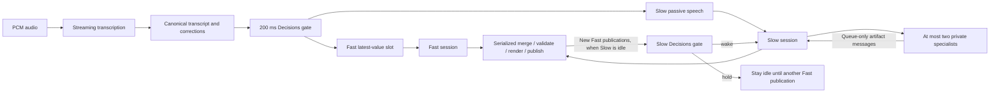

# Talkdeck orchestration

> Consolidated on 2026-10-31 by explicit user instruction. This document preserves the legacy HTML scheduler/control
> contracts and historical measurements; it does not describe a separate npm package anymore. Code is now under
> `src/orchestration/`, tests under `test/orchestration/`, and original WAV/text fixtures under `fixtures/legacy/`.
> The actual actor scheduler now also accepts the canonical JSX backend; see the [current host integration](../HOST_PORT.md)
> and [package commands](../../README.md). Historical `runs/...` paths and test counts below retain their original
> provenance and may not exist in a fresh checkout. They are not integrated five-talk results. Frontend work remains separate.

Deck-level, talk-first generation using **OpenAI only**. Runtime code lives under `src/orchestration/` inside the combined package. Dependencies use the single root manifest/lockfile;
run output defaults to `.artifacts/legacy-runs/`. Original text/WAV inputs live under `fixtures/legacy/`.
The five-slide fixture exercises explicit navigation and persistent sessions.
See [DECK-CONTRACT.md](DECK-CONTRACT.md) for navigation, pause and structure semantics.
Frontend integration is not part of this change.

## Developer handoff

Start with [HANDOFF.md](HANDOFF.md), then the
[product idea](PRODUCT-IDEA.md) and
[design decisions](DESIGN-DECISIONS.md). These preserve historical behavior and measurements.
The [current host integration](../HOST_PORT.md) describes the implemented canonical backend.

## Run

Tested with Node.js 24. See [VERIFICATION.md](VERIFICATION.md) for test evidence
and measured latency limitations.

```sh
# From slide-generation/
npm ci
npx playwright install chromium
npm run check
npm run test:orchestration
node --import tsx src/orchestration/fixture.ts             # Real WAV -> live STT -> Decisions -> Fast/Slow -> slide
node --import tsx src/orchestration/fixture.ts --text   # Optional paced text replay, not an audio integration test
node --import tsx src/orchestration/fixture-deck.ts # Five-slide WAV, explicit next/jump, pause/resume
node --import tsx src/orchestration/fixture-deck.ts --assets # Also request specialist image/component integration
node --import tsx src/orchestration/audit-deck.ts .artifacts/legacy-runs/<deck-run> # Rendered five-slide content/control audit
node --import tsx src/orchestration/smoke-assets.ts # Real Flare + deterministic specialist/component smoke
npm run legacy:server      # Legacy HTTP/SSE API on 127.0.0.1:8787
node --import tsx src/orchestration/audit-fixture.ts .artifacts/legacy-runs/<run> # Fixture content/lifecycle checks
node --import tsx src/orchestration/replay-publications.ts .artifacts/legacy-runs/<run> # Recorded edits through current publisher
```

Credentials: `OPENAI_API_KEY` or `OPENAI_KEY`, from process environment only. Source `.env` in the shell
with `set -a`, `source ./.env`, then `set +a`; code never reads it. No key is sent to a browser or written to run logs. Fixture commands make paid API
calls. Defaults are `gpt-live-transcribe`, `gpt-6-luna` for Decisions/Fast,
`gpt-6-sol` for Slow/specialists, and **`gpt-image-2.5-flare`** for the specialist
`image_generate` tool (PNG; low/medium/high quality and square/landscape/portrait sizes).
Override with `TRANSCRIPTION_MODEL`, `DECISION_MODEL`, `FAST_MODEL`, `SLOW_MODEL`,
`SPECIALIST_MODEL`. The image tool is deliberately pinned to Flare 2.5.
`RUN_DIR` controls fixture output;
`REPLAY_SPEED=1` is real-time playback, higher values are accelerated stress tests.
Fast uses Luna, `service_tier: "fast"`, and reasoning `none`. Slow uses Sol,
`service_tier: "fast"`, and reasoning `medium`. Specialists retain Sol with low
reasoning and now also request Fast tier. Decisions records its endpoint-default policy because its API does not expose a tier field. A direct Luna probe
accepted and served `fast`; `ultrafast` returned HTTP 400 (invalid service tier).
The current provider path disables hidden SDK retries and records each request attempt. The fixture verifies API connectivity
before sending audio and reports failure if its final transcript cannot be evaluated.

## Architecture



### Dispatch

The clock ticks every 200 ms, independent of speech arrivals and silence. With
undispatched text, it calls the native Decisions endpoint with a dispatch/hold
choice. Dispatch permits reasoning, not mandatory mutation. Hold retains speech.

Each slide retains its own speech gate; up to eight decision calls per gate may overlap; occupied-capacity ticks are skipped, not
queued. Each call has a 30-second deadline. Errors retain text and use bounded
backoff. These are explicit overload policies; the service does not promise
200 ms API latency or a request start on every tick under overload.

Each decision evaluates an immutable snapshot. Its result is discarded if its
last-dispatch baseline changed or newer recognition corrections invalidated its
wording. Accepted dispatches send that evaluated snapshot; later append-only
speech stays pending for the next tick. Fast has one replaceable speech value **per slide**, containing that slide's whole
transcript and accumulated correction context. Pending slides are processed in
arrival order within the same persistent Fast session; a newer value for a slide
replaces its pending value without dropping other slides.

### Agent sessions

Each actor preserves conversation/tool history; only one inference runs in an
actor at once. Different actors may infer concurrently. Before each model call,
arrived messages/tasks/speech, statuses and the current observation are supplied.
Running inference input is never mutated. Latest two distinct observations
include actual PNG image inputs and source; older observation bodies remain in
logs and become references in projected model history.

Actors can call `finish` to end an activation without ending the session; required
child results and newer pending work still take precedence. A tool-free response
also finishes. This avoids using no-op edits as a completion signal.

Fast handles routine additions and initial composition. Slow refines semantics,
hierarchy and visual explanation. Neither owns a slide region. Passive speech is
labelled as already sent to Fast and never wakes or forces continuation of Slow.
Accepted state-changing Fast publications make idle Slow eligible for a separate
Decision API evaluation, **not an automatic wake**. This event-driven gate returns
`wake` or `hold` using the current source, actual PNG, geometry, diagnostics,
passive speech, queued messages and last observed Fast watermark. It uses the
same `DECISION_MODEL`; the speech gate still runs on its own 200 ms clock.

Only one Slow decision runs at once. Fast publications arriving during a decision
coalesce into the latest candidate; a result for an obsolete slide is discarded.
Active Slow gets no per-publication decision or mailbox broadcast. When it finishes,
unseen Fast publications trigger one coalesced evaluation. A `hold` leaves Slow
idle until a newer Fast publication; it does not poll the same unchanged slide.
Slow's own publications, passive speech and ordinary mail do not independently
trigger this gate. Explicit `followup_task` requests bypass it; starting Slow
invalidates any older pending eligibility result, even if that activation finishes
before the decision returns.

Slow decision requests have a 30-second deadline and no automatic retries. Failure
never implies `wake`: it emits `slow_decision_error`, keeps Slow idle and makes
`settle()` report failure when current work drains. A newer Fast publication can
retry eligibility, or an explicit task can proceed. Shutdown cancels pending
requests; settlement includes pending Slow decisions.

Slow can delegate, message, follow up and wait. Specialists create immutable
private artifacts (SVG, component HTML/CSS, text or generated image). Only Slow
integrates those artifacts. Two active specialists are allowed. Completion queues
information; a waiting parent resumes its existing activation. `send_message`
never wakes idle recipients; `followup_task` requests work without duplicating
active turns. Required outstanding specialist tasks prevent Slow from finishing.
Their completion must reach a model boundary before Slow can finish, including
when the child finishes during a running inference. A failed specialist remains
visible in status, but does not fail settlement after Slow observes the failure
and finishes successfully.

The 64-step safety budget bounds work without fresh input. Dispatched Fast speech,
new Fast publications observed by Slow, explicit tasks and required specialist
completions renew it, so continuous narration does not exhaust an activation's
budget. Passive speech alone still cannot keep Slow running.

### Editing and publication

`view_slide()` and `edit({ old, new })` return the actual current observation.
`old` must match exactly once in the inference's supplied source; insertion
expands a fragment, and empty `new` deletes. Multiple edits use that inference's
original private source plus its preceding successful changes, never unseen
concurrent edits. Agents supply no versions or dependency declarations.

Publication serializes exact replacement, conservative three-way merge,
validation, Chromium rendering and state swap. Disjoint/identical changes merge;
ambiguous targets/incompatible overlaps fail. Validation/render failure leaves
source and screenshot unchanged. Every accepted state-changing edit creates one
undo unit; no-ops create none. Stale Fast merge conflicts forward intent and
supporting speech to Slow once. Neither side gets automatic precedence or retry.

Chromium checks execution errors, duplicate IDs per document/shadow scope,
unregistered custom elements, missing fragment/image references and external
asset requests. Registered assets are content-addressed and copied on read/write.
Geometry and off-slide overflow are returned; visual diagnostics are advisory.
Static rendering freezes page time and disables CSS animations/transitions to
avoid number tweening. Successful rendering does not prove factual accuracy.

### Deck navigation, pause and broader edits

`nextSlide()` selects an existing next slide or creates a blank slide at the end.
`selectSlide(id)` jumps without recreating either agent. User selection and agent
working targets are separate. In-flight Fast edits remain bound to their original
slide. A removed target is rejected and Fast stops that obsolete narration rather
than copying it to the survivor. Slow sees every slide's source and attributed
narration at model boundaries; the latest two inspected source/PNG observations
remain actual image inputs. Later context can therefore correct a past slide.

`pause()` stops new decisions/inferences/tools and blocks agent publication.
Already-issued requests may finish, but their results wait at a resume boundary.
A candidate render crossing a pause boundary is rejected even if resume happens
before render completes. `resume()` continues preserved histories and pending work.
Navigation and explicit user split/merge remain available while paused. Audio may
continue to accumulate while agent work is paused; this is not microphone mute.

Slow has `edit_slides`, `split_slide`, and `merge_slides` tools. Cross-slide edits
and structural transactions validate/render all candidates before any state swap.
They have one internal undo record, preserve selection where possible, and reject
stale source or incompatible structure. Split keeps the original ID for its first
part; merge keeps the first adjacent input ID and remaps a removed selection to it.
Removed narration is archived in deck context. Only Slow introduces private
specialist artifacts; specialist tasks and returned assets retain their target
provenance through navigation. Specialists receive actual relevant screenshots.

Pointer grounding, feedback approval and practice/presentation modes remain
separate contracts. Narration is attributed to slides, but polished speaker-note
generation is not added here. There is no AI speech output and agents never
advance/select slides.

### Push-to-edit and undo/redo

`runtime.pushToEdit(prompt, slideId?)` submits a simple explicit edit comment to
Slow, bypassing Decision eligibility. The selected slide ID is captured when the
comment is submitted unless a target is supplied. The prompt is delivered as an
`edit_comment` task at the next model boundary, never appended to narration.
There is no additional model, microphone mode, selection protocol, or approval
flow. Comments queue while paused. A queued comment whose target was removed is
reported obsolete, not silently redirected. Receipt acknowledges queuing, not
successful publication; ordinary publication/error events report the result.

`runtime.undo()` / `runtime.redo()` restore deck-level snapshots. One successful
state-changing tool transaction is one undo unit, including a batch edit, split,
merge, or creation of a new slide. A new state-changing transaction clears redo;
rejections, no-ops, pause, and navigation do not. The currently selected stable ID
is retained if it exists in the restored deck; otherwise the snapshot's selection
is restored. Sources, titles, order, immutable asset references, and validated
frames are restored together. Observation IDs and deck revisions stay fresh.
History is in-memory for the lifetime of the session, not durable storage.

Undo/redo are **cancellation boundaries**, unlike pause/resume. They invalidate
old publication branches, cancel active agent/Decision/specialist work, and clear
older pending tasks and speech dispatches. Late provider results cannot publish,
create artifacts, or wake parents. Transcripts and conversation/tool histories
remain; the current transcript is marked consumed so old narration does not
immediately regenerate an undone change. Restored slide IDs recover their
archived narration and revision baseline. Fresh speech or a new edit comment can
start work again; input arriving during restoration is retained. The agents are
explicitly told the restored deck overrides historical tasks and narration.

Undo/redo work while paused without resuming agents. Empty stacks return
`unchanged` and do not cancel active work; undo does not cancel the very first
unpublished edit when there is nothing to undo. Status includes `canUndo`,
`canRedo`, `undoDepth`, and `redoDepth`. Use runtime controls for a live session;
`Publisher.restoreHistory()` is the low-level serialized restoration primitive,
not the actor/transcript cancellation coordinator.

## HTTP API

The API binds to localhost. Use the exported `SlideRuntime` directly for embedded
integration; `interfaces.ts` exports the public module types. Embedded callers
supply both `decider: Decider` (speech dispatch) and `slowDecider: SlowDecider`
(refinement activation). Production HTTP and fixture entry points wire both to
the OpenAI Decisions API.

| Method | Path                         | Contract                                                                           |
| ------ | ---------------------------- | ---------------------------------------------------------------------------------- |
| POST   | `/sessions`                  | JSON `{context?, initialSource?}`; creates a persistent deck starting with one slide                       |
| GET    | `/sessions/:id`              | Statuses and current observation ID                                                |
| POST   | `/sessions/:id/transcript`   | JSON `{text, revision, slideId}`; increasing full-text snapshots per slide                            |
| POST   | `/sessions/:id/audio`        | Raw mono 24 kHz PCM16; session-wide `X-Audio-Sequence` and `X-Slide-ID`; send serially |
| POST   | `/sessions/:id/audio/commit` | End audio turn; wait for final transcript                                          |
| GET    | `/sessions/:id/events`       | SSE; reconnect with `Last-Event-ID` for event replay                               |
| GET    | `/sessions/:id/screenshot`   | Current published PNG, never a partial candidate                                   |
| GET    | `/sessions/:id/slide`        | Sandboxed current HTML document                                                    |
| GET    | `/sessions/:id/assets/:hash` | Immutable asset content                                                            |
| DELETE | `/sessions/:id`              | Cancel work and close browser/transcription connections                            |

Additional deck controls:

| Method | Path | Contract |
| --- | --- | --- |
| GET | `/sessions/:id/slides` | Deck order, stable IDs, full sources, narration and selection |
| GET | `/sessions/:id/slides/:slideId` | Source, observation ID, geometry and diagnostics |
| GET | `/sessions/:id/slides/:slideId/slide` or `/screenshot` | Specific slide HTML/PNG, independent of selection |
| POST | `/sessions/:id/next` | Explicit next; creates at the end; returns selected ID |
| POST | `/sessions/:id/select` | `{slideId}`; explicit jump |
| POST | `/sessions/:id/pause` or `/resume` | Suspend/resume agent work session-wide |
| POST | `/sessions/:id/push-to-edit` | `{prompt, slideId?}`; returns `{id, slideId, requested:true}` with HTTP 202 |
| GET | `/sessions/:id/history` | `{canUndo, canRedo, undoDepth, redoDepth}` |
| POST | `/sessions/:id/undo` or `/redo` | Returns `{outcome:"restored"|"unchanged", direction, selectedId, history, deck}` |
| POST | `/sessions/:id/work` | `{agent?:"slow"|"fast", task, facts?, slideId?}`; explicit work bypasses eligibility |
| POST | `/sessions/:id/split` | `{slideId, observationId, parts:[{title,source},...]}`; stale snapshot rejected |
| POST | `/sessions/:id/merge` | `{slideIds, observationIds, merged:{title,source}}`; adjacent slides in order |

After the deck has multiple slides, explicit transcript `slideId` and audio
`X-Slide-ID` are required. Audio chunks for a different selection are rejected.
Clients should buffer unsent PCM while awaiting a navigation response, then send
it with the returned slide ID and the next audio sequence. Rejected stale-target
chunks do not consume a sequence number.
Navigation finalizes the current audio segment before switching; transcription
callbacks capture that segment's original slide ID. Returning to a slide appends
a new segment to its previous transcript with increasing revisions. Mutating
requests serialize per session (pause/resume are immediate barriers).

SSE includes `slide_selected`, `deck_changed`, `work_paused`, `work_resumed`,
`work_obsolete`, and slide-attributed `published`/`transcript` events.
Push-to-edit adds `edit_comment_queued` and `edit_comment_obsolete`; restoration
emits `history_changed` as well as `deck_changed`. Publication/deck-change events
include current history availability. `GET /sessions/:id` also includes history.
Undo/redo finalize the current audio segment before changing the deck, like navigation.

A session uses either audio or direct transcript input, not both. No frontend
files have been changed. A deployment needs its own authentication and session
retention policy; this is a local single-process runtime, not a durable cluster.

## Verification and observability

`npm test` uses deferred fake model responses to exercise actual races, plus
real Chromium validation and the prepared WAV format. Live fixture runs save:

- `transcript.txt`, the actual transcription (audio mode).
- `events.jsonl`, decisions, exact inference inputs, tool results and publication logs.
- Immutable observation HTML/PNG files.
- `final.html`, `final.png` and `summary.json`.

The tests cover Slow wake/hold eligibility, coalesced/stale Slow decisions, explicit-task
bypass, shutdown and failure handling, speech replacement, stale speech decisions, overlapping decision calls,
recognition corrections, session serialization, passive Slow context, coalesced
wakeups, queue-only mail, waiting specialists, specialist concurrency, exact-match
editing, merge conflicts, rollback, immutable assets and image-history projection.
Run logs and screenshots support the end-to-end audit; the unit tests alone do
not establish visual or semantic quality of a generated presentation.

## Five-slide narration fixture

`fixtures/legacy/test-fixture-5-slides.txt` expands the fictional library pilot into
problem framing, workflow/trial setup, results, staffing/limitations, and a
bounded extension. It deliberately includes a same-slide sample-size correction
and a correction on slide 4 to the satisfaction figure spoken on slide 3.
Illustrative calculations and proposed thresholds are explicitly distinguished
from measured results.

Generate the matching audio with:

```sh
# From slide-generation/
node --import tsx src/orchestration/generate-five-slide-fixture.ts
```

This uses OpenAI TTS with `TTS_MODEL` / `TTS_VOICE` overrides (defaults:
`gpt-4o-mini-tts` / `alloy`). It writes `fixtures/legacy/test-fixture-5-slides.wav` and
`fixtures/legacy/test-fixture-5-slides.json`, preserving the original single-slide fixtures.
Unchanged per-slide audio is cached under ignored `.artifacts/legacy-tts/` to
avoid repeat generation charges.

The WAV is mono, 24 kHz, 16-bit PCM, with 1.2 seconds of silence between slides.
Headings are not spoken. JSON contains exact segment sample offsets, timestamps,
script/audio hashes, expected final facts, and cross-slide correction targets.
These boundaries are fixture metadata for explicit navigation; they do
not define a speech-driven slide-switching contract. `fixture-deck.ts` uses these boundaries to simulate explicit next/jump controls,
with independent transcription segments and one continuing agent session. The
original `fixture.ts` remains a single-slide regression runner.

## Documentation used

- [OpenAI Decisions](https://developers.openai.com/api/docs/guides/decisions)
- [Responses function calling](https://developers.openai.com/api/docs/guides/function-calling)
- [Realtime transcription](https://developers.openai.com/api/docs/guides/realtime-transcription)
- [Node SDK response-history normalization](https://github.com/openai/openai-node/blob/main/docs/responses.md)

Exact dependency versions are recorded in `package-lock.json`. No Vercel SDK or
Codex coding-agent harness is used for the main runtime.
