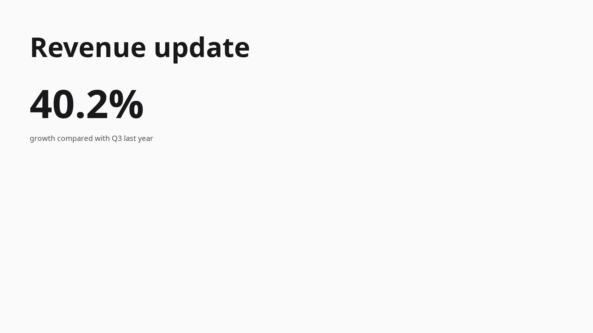
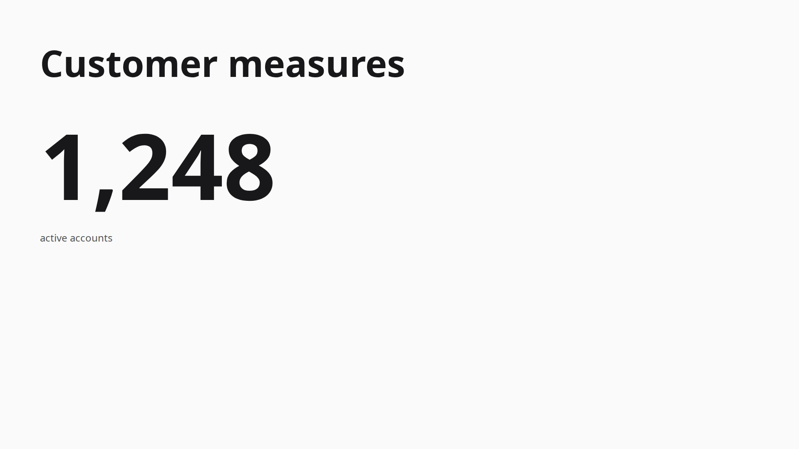

# Headless integration and first improvement iteration — 2026-10-31

The actual orchestration scheduler now generates canonical JSX through real hashline tools, mandatory Chromium checks,
durable commits and the packaged viewer without a frontend. The two packages are consolidated under `slide-generation/`.
This is a bounded integration pilot and the start of the improvement loop, not five-talk qualification.

## Baseline and measurement

Frozen source: `5f970fbd0ad88451c72fe3d74a6b615ef4e8fffc`, exported under
`.artifacts/baselines/headless-pre-fix/`; archive SHA-256
`ea98620a0e97485ea6b27373460ec2772c8c323cd4019e129e9af8a6f879a429`.
The first freeze attempt refused an uncommitted review document; the successful freeze followed its commit.

Pilot artifact directory: `.artifacts/runs/headless-integration-2026-10-31/pilot-01/`.
The pilot began at `3d5642d`; its manifest correctly says dirty because replay CLI files were still untracked.
The frozen source includes those CLI and review additions; no generator behavior changed between pilot and freeze.
Exact source/prompt/dependency metadata and all requests/responses are preserved in the run. Credentials were shell sourced.

| Observation | Pilot 01 |
|---|---:|
| Real provider calls | 26 |
| Observed input / output tokens | 153,757 / 676 |
| Responses served Fast | 12 / 12 |
| Decisions requests, endpoint-default tier | 14 |
| Provider errors / retries / aborts | 0 / 0 / 0 |
| Exact retained original inputs | 3 / 3 |
| Accepted visual edits / stale-anchor refusals | 2 / 1 |
| Final live slides | 2 |
| Final readiness errors / Pending | 0 / 0 |
| Automated visible expectations | 2 successes, 1 reported miss |
| Successful visible-correct latencies | 8.03 s, 10.54 s |
| Recorded viewer PNGs | 10, plus video |
| Cost | Unknown; no invented dollar estimate |

The reported qualifier miss is an evaluator granularity defect: the expected phrase “compared with Q3 last year” is
preserved within the native Stat label “growth compared with Q3 last year”, rather than as a standalone text node.
The original report remains unchanged. Manual inspection of the source and screenshot confirms preservation. This does
not convert the original automated score into a silently revised pass or establish whole-suite faithfulness.

The successful latency sample has only two observations and excludes the miss. It establishes neither a typical
latency distribution nor a complete worst case. No acoustics/ASR, audience builds, Slow generation or specialist
generation were exercised. The screenshots below are final exports; the run's original PNG/video gallery preserves
what was actually visible over time.

Visual review: readable native values, no visible overlap, sparse layouts and consistent left alignment. Styling remains
plain and the first metric is smaller than the second. This is limited manual evidence, not a complete design rating.

## Diagnoses and small fixes

See [provider trace](cases/pilot-provider.md) and [preflight review](preflight-review.md).

1. **Measurement correctness:** wrong-target routes can incorrectly establish expected slide identity; full textContent
   can overclaim clipped visibility; exit ghosts can remain during a correction. Establish aliases from independently
   verified creation events and use conservative visibility evidence. Apply the same evaluator to both versions and
   record evaluator provenance separately. Preserve old raw recordings and scores.
2. **Selected-slide deletion:** a canonical deletion reaches the session before the backend updates its selected ID.
   Resolve the nearest surviving slide against that committed revision before publishing. Invariant: viewer and backend
   agree, deletion archives source, and no deleted-ID publication poisons the recording. Verify a real Chromium regression.
3. **Named edits:** selected slide and named edit target must be separate. Route only actual user words, never evaluator
   aliases. Unknown/ambiguous titles must remain explicit failures with durable raw input. Do not implement fixture answers.
4. **Scheduling hypothesis:** overlapping Decisions for the same revision produced nine stale results. This is measured
   redundant work, not yet proof that coalescing improves visible latency. Preserve the fixed polling contract; compare
   any candidate against this frozen source before claiming an improvement.

These are implementation/instrumentation issues; no new product choice has been inferred. D56's bounded Stat counting
remains accepted. Image/font provider integration remains provisional.

## Verification and unfinished work

Before the live pilot, TypeScript and all 287 tests passed, including real Chromium. Two fault-injection host runs verified
partial evidence and cleanup survive readiness/screenshot/viewer failures, with zero API calls.

`npm run headless:replay -- --run .artifacts/runs/headless-integration-2026-10-31/pilot-01 --out .artifacts/replays/headless-pilot-01`
passed 10 recorded steps with real browser checks and no model fallback. Final source SHA-256:
`35a6018667fb0162a1dec61a33c1ab3ea9d2973cb548cf1c7caad4d2541010de`; final readiness passed.
This is transaction replay, explicitly **not actor replay**. Actor replay, five timed talks × three fresh repetitions per
version, frozen A/B comparison, complete semantic/audience review and separately verified refactoring remain unfinished.
