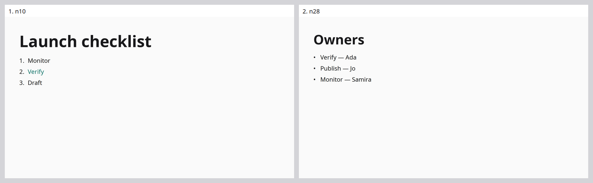

# Round 03: visible generation after the marker fix

This is one new live edit-heavy run of frozen generator `734d84a7be9b4924e0c4ee0213d598cc2564826a`, after repairing numbered bullet typography metadata. It is distinct from the offline reconstruction/render of round 02. Real checked edits now reach the viewer, but this run remains unfaithful and terminates with host-error. The [individual case](cases/edit-heavy-01-visible-but-unfaithful.md) traces the accepted wrong edit, failed recovery, Slow context omission and unresolved target.

## Entire final deck

The user requested that later passes show screenshots of the **entire deck concatenated into one image**. Use the existing final slide images, canonical live-slide order, numbered ID labels and a verified complete set. A missing/duplicate/invalid capture must be reported explicitly; never present a partial sheet as the entire deck. These are native image compositions, with no generative alteration.

This 1968×612 PNG combines both original 1920×1080 JPEGs at 960×540 each, ordered `n10`, `n28`. It was generated offline in a new review directory after the run, using zero model calls. The [status/provenance sidecar](../../../.artifacts/review/round03-deck-contact-sheet/contact-sheet-status.json) records canonical source SHA, both image hashes, count, order and coordinates. The original run images, report and scores were not rewritten. The sheet shows final captures; it cannot substitute for the [original viewer timeline and video](../../../.artifacts/runs/headless-round-03/candidate/edit-heavy/1/execution/slide-generation/.artifacts/run/viewer-gallery.html).

The visible final checklist is wrong: Launch instead of Release, Publish and the requested caption missing, Verify still highlighted, items in the wrong order. Owners has the correct latest pairings: Verify — Ada, Publish — Jo, Monitor — Samira. Readable typography and no obvious overlap in these final screenshots do not compensate for those fidelity failures. Owners still follows checklist despite the reorder request.

## Recorded measurements

| Measurement | Recorded result |
|---|---:|
| Provider calls | 84 |
| Fast / Slow / specialist Responses calls | 26 / 4 / 0 |
| Speech / Slow Decisions calls | 49 / 5 |
| Observed input / output tokens | 894,397 / 3,396 |
| Fast input / output tokens | 818,401 / 2,973 |
| Slow input / output tokens | 49,416 / 423 |
| Speech / Slow Decisions input tokens | 21,476 / 5,104 |
| Responses actually served Fast | 30 / 30 |
| Decisions tier | 54 endpoint-default requests; returned tier unreported |
| HTTP errors / aborts / unknown-usage calls | 0 / 0 / 0 |
| Durable input receipts / expected inputs | 22 / 22 |
| Exact canonical live/archive Prompts | 21 / 22 |
| Maximum delivery drift / receipt delay | 18.712 ms / 92.839 ms |
| Model edit attempts / accepted / refused | 11 / 6 / 5 |
| Accepted Fast visual edits / Slow deletion | 5 / 1 |
| Final live slides / archived slides | 2 / 1 |
| Final structural readiness | true |
| Automated expectations: pass / fail / manual review | 3 / 12 / 15 |
| Automated coverage | 3/30 = 10% |
| Successful p50 | 7,193.077 ms |
| Successful p90 / p95 / observed maximum | 11,693.775 ms |
| Recorded viewer PNGs | 26, plus video |
| Termination / aggregate recording completion | host-error / false |
| Cost | unknown |

Configured per-run limits were 600 calls, 8,000,000 input tokens and 250,000 output tokens, with 8,000 output tokens per call. No limit was reached. All 84 HTTP responses were 200. The provider usage is observed, not an invented dollar estimate.

The three successful observations are initial title presence (7,193.077 ms), Review→Verify correction (11,693.775 ms), and title wording preservation after the enlargement instruction (5,517.207 ms). The last assertion alone does not prove the size change. Twenty-seven other expectations remain misses/manual reviews. Their absence from latency quantiles is explicit; the observed maximum is not a whole-run worst case. No speed or cost improvement is claimed for this incomplete work.

The driver-level recording field is true despite host-error, but aggregate review completion is false. Durable receipt, complete recording and successful canonical integration are different guarantees. The missing canonical utterance is 021: it names Release checklist before the rename has committed; raw pending evidence survives. Final readiness validates structure/layout and Pending state, not requested-content coverage.

## First divergences and what they imply

- The accepted Publish→Draft transaction uses an accurate issued read and hash. It replaces the literal Publish line with a new Draft while another Draft already exists. This is a model-authored semantic mispatch, not stale context or an engine applying the wrong anchor. Removing the duplicated ID from a refused attempt made the wrong text replacement syntactically valid.
- Five refusals enforce real contracts: one color token spelling, one unissued snapshot, one duplicate ID and two reintroduced deleted IDs. Later bundled repair attempts therefore also fail to rename the title or add the caption. The engine must retain these identity/hash protections.
- All five automatic Slow gate requests omit actual visual source/content, supply empty geometry/diagnostics, and contain no image. All answer hold. That proves an observation gap, not that an informed Slow gate would necessarily repair the deck.
- An explicit exact-utterance handoff does wake Slow. It deletes Parking lot and preserves its original creation/deletion transcript and notes in the archive. Automatic refinement, reorder and theme behavior are still unproven.
- Owners assertion a028 expects standalone names while the visible nodes contain complete task/name pairings. Manual review confirms those latest pairings; the original whole-node automatic miss remains unchanged.

## Next combined candidate hypotheses

1. **Stable utterance delegation:** use an actual retained utterance's stable ID and exact text for cross-slide handoff, instead of asking the model to reconstruct an aggregate quotation. Verify receipt, target and exact evidence before waking Slow. This should reduce avoidable delegation refusals; it cannot itself prevent literal visual mispatches.
2. **Actual canonical source for Slow:** supply the committed visual source/content that the decision is meant to inspect, preserving revision and slide identity. Do not substitute titles/notes for the result, or silently add automatic screenshots. Verify the actual serialized request, then measure whether decisions and edits improve.
3. **Pending rename aliases:** associate an explicit retained rename request with its known stable slide ID while the visual rename is pending. Preserve the distinction between intended and committed title, reject ambiguous references, and never use fixture aliases or silently select another slide. Verify that a later named command remains canonical and reaches the intended target even when generation lags.

These are hypotheses for a combined candidate, not isolated causal results or new product promises. Retain this failed trial, add focused tests and recorded-response replay, freeze the next candidate and remeasure. Test replay must preserve the original wrong model patch rather than silently repairing it. Full five-talk repetitions, separate live audience/build review, broader semantic/design review and separately verified refactoring remain unfinished.

## Immutable evidence

- [Run report](../../../.artifacts/runs/headless-round-03/candidate/edit-heavy/1/execution/slide-generation/.artifacts/run/review.md)
- [Driver record](../../../.artifacts/runs/headless-round-03/candidate/edit-heavy/1/execution/slide-generation/.artifacts/run/driver-result.json)
- [Provider accounting](../../../.artifacts/runs/headless-round-03/candidate/edit-heavy/1/execution/slide-generation/.artifacts/run/provider-statistics.json)
- [Metrics](../../../.artifacts/runs/headless-round-03/candidate/edit-heavy/1/execution/slide-generation/.artifacts/run/metrics.json), [audit](../../../.artifacts/runs/headless-round-03/candidate/edit-heavy/1/execution/slide-generation/.artifacts/run/audit.json), [failure](../../../.artifacts/runs/headless-round-03/candidate/edit-heavy/1/execution/slide-generation/.artifacts/run/failure.json)
- [Final canonical source and archive](../../../.artifacts/runs/headless-round-03/candidate/edit-heavy/1/execution/slide-generation/.artifacts/run/final/deck.jsx)
