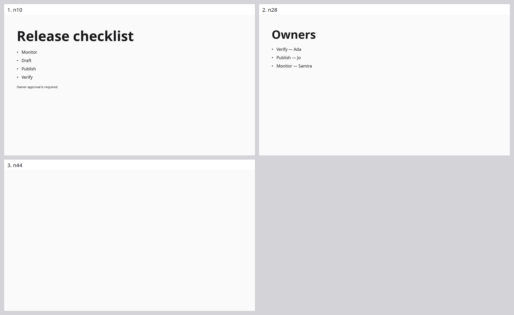
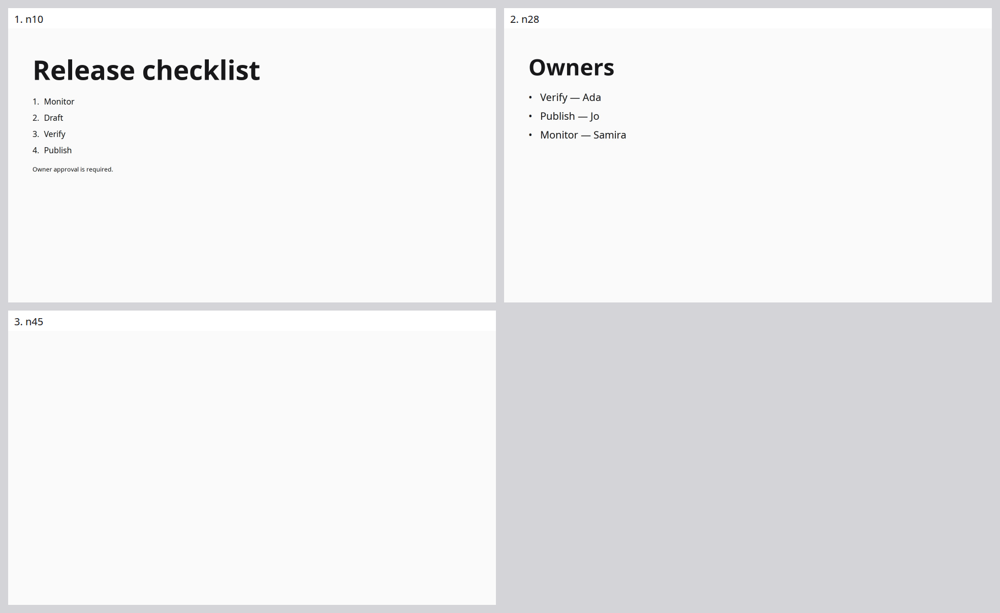

# Pass 1 — establish working generation and diagnose fidelity failures

Date: 2026-10-31. This report consolidates the four earlier diagnostic rounds into one implementation pass. It covers
seven real edit-heavy trials, their targeted fixes and offline replays. The trials remain distinct observations with
original versions, timings and scoring; consolidation does not turn them into one experiment or repeated qualification.
The integration pilot is separate [pre-pass evidence](../headless-integration-2026-10-31/README.md).

## Outcome

The subsystem progressed from blank output to checked, durable, visible edits through the real actor scheduler and
viewer. Mandatory validation, exact source retention, named routing, broader-edit handoff and complete-deck reporting
now have live evidence. Faithfulness remains insufficient: final ordering, deletion and build requests are still missed.
The final paired trial supports **no overall quality, speed or cost improvement**. Structural readiness is not content
correctness. Full repeated five-talk qualification and later refactoring are unfinished.

## Evidence and changes within this pass

| Stage | Frozen/source versions | Live evidence | Diagnosis and verified change |
|---|---|---|---|
| [1: blank output](stages/01/README.md) | `5f970fb` / exploratory `8df2d2a` | 76 / 77 calls; both blank; candidate host-error | Actionable editing context, stable insertion boundary, named targeting, deletion publication and broader-edit handoff |
| [2: unavailable validation](stages/02/README.md) | `5f970fb` / `16a1671` | 77 / 74 calls; 0/30 each | Exact recorded draft exposed missing typography roles on generated bullet markers; fixed measurement and diagnostic details |
| [3: visible but unfaithful](stages/03/README.md) | `734d84a` | 84 calls; 3/30; host-error | Literal wrong edit, hidden source in Slow decisions, fragile quotation handoff and unresolved pending rename |
| [4: completed frozen pair](stages/04/README.md) | `734d84a` / `7aee9be` | 89 / 88 calls; 8/30 each; both settled | Actual Slow source and original utterance-ID handoff exercised; pending aliases have regression tests, not live proof in this pair; order/deletion/builds remain |

Stage 1's original 1/30 scores were vacuous absence passes on blank output. They remain in the original recordings;
later scoring requires earlier visible content. The exploratory dirty harness and changes in measurement are explicit
in the stage reports. Scores across stages must not be treated as a controlled improvement curve. Stage 4 is a matched
pair, but its successful expectation sets differ, so its 6,292.166 versus 5,660.394 ms successful p50 values do not justify
a speed delta. Costs are unknown; per-trial call and token counts are retained in the linked reports.

## Complete final decks from the last paired trial

Baseline `734d84a`: all three actual slides, including the unwanted blank Parking lot.

Candidate `7aee9be`: all three actual slides. Verify precedes Publish despite the requested opposite order.

Both preserve all 22 original inputs and pass final structural checks. Both miss moving Owners before the checklist,
deleting Parking lot and adding the requested build groups. The baseline's final checklist order is correct; the
candidate regresses it. No slide was removed from these images to improve appearance. Full viewer videos and intermediate
frames remain under the original run directories; final images do not prove animation or earlier correctness.

## Verification and remaining work

The final implementation passed TypeScript and all 318 tests, including actual Chromium. Offline transaction replay
reproduced stage 4 exactly: 46 baseline steps and 55 candidate steps, matching final source and real browser checks.
The integration pilot has a separately verified 26-request actor replay. Full-talk actor replay still has explicit
lifecycle and navigation limits; see the [bounded extension plan](stages/04/replay-plan.md).

The original `.artifacts/runs/headless-round-01` through `headless-round-04` directories, freezes, request recordings,
comparison reports and replay outputs are unchanged. Their historical names are evidence identifiers. The stage folders
retain individual cases and source links rather than duplicating them in this overview.

The next pass broadens measurement to the other four original talks and adds separate fixtures for mixed layouts,
theming, decoration and motion. Existing five-talk results and new quality fixtures remain separate comparison strata.
See [current continuation](../../continuation/README.md) for active run locations and next actions.
