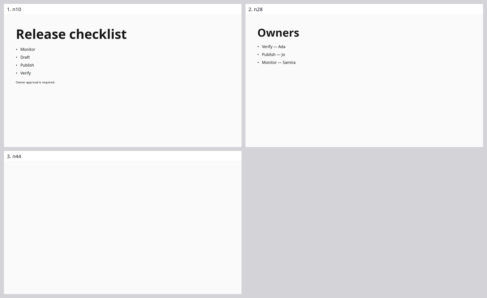
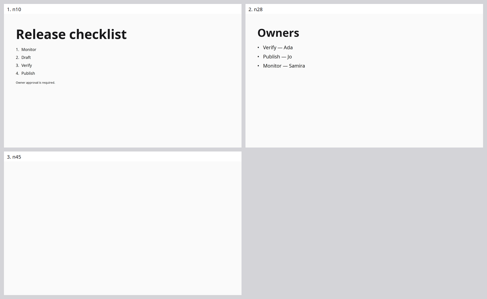

# Pass 1, stage 4 — matched edit-heavy pair, useful output with unresolved fidelity failures

Historical stage evidence within the [consolidated Pass 1](../../README.md). Original artifact names and trial outcomes are retained.

One serial pair compared frozen baseline `734d84a7be9b4924e0c4ee0213d598cc2564826a` with candidate `7aee9be498d77435d2cca642f4f4000143e364a0`. Both completed recording and settled. Both preserve all 22 inputs in canonical source and pass structural readiness, but neither produces the requested final two-slide deck. Both score 8/30 automatic successes, with different successful expectations. The candidate's final checklist order is worse than the baseline's. **This pair establishes no quality, speed or cost improvement.**

## Entire final decks

These PNGs are byte-for-byte copies of each run's complete-deck contact sheet, composed from its original final slide JPEGs. All three actual live slides appear in canonical order, including the unwanted blank Parking lot slide. Nothing was cropped out, regenerated or repaired for this report. The original evidence remains unchanged.

### Baseline — `734d84a`

Checklist has the requested final title, items **Monitor, Draft, Publish, Verify**, caption, and no Verify highlight. Owners shows the latest correct associations: Verify — Ada, Publish — Jo, Monitor — Samira. However, Owners still follows checklist, Parking lot remains as a third blank slide, and no build groups were authored.

### Candidate — `7aee9be`

Checklist has the requested final title and caption, but its order is **Monitor, Draft, Verify, Publish**. The explicit instruction “Move Publish before Verify” is therefore unfulfilled in the final deck. Owners has the correct latest associations. The same wrong slide order, undeleted blank Parking lot and absent build groups remain. Final captures cannot establish live reveal behavior or retrospectively satisfy earlier owner-correction windows.

Both decks use a sparse neutral layout, left alignment, strong title hierarchy and legible native text in the inspected images, without obvious clipping or overlap. The candidate uses numbered checklist markers where the baseline uses dots; this is a visible design difference, not evidence of a better interpretation. The candidate's Owners list is larger than its checklist list. These limited visual observations do not override the fidelity and missing-work findings.

## Recorded pair statistics

| Measurement | Baseline | Candidate |
|---|---:|---:|
| Real provider calls | 89 | 88 |
| Input tokens | 938,894 | 1,112,369 |
| Output tokens | 2,851 | 6,204 |
| Fast / Slow Responses | 24 / 9 | 24 / 15 |
| Speech / Slow Decisions | 52 / 4 | 46 / 3 |
| Specialist calls | 0 | 0 |
| Responses actually served Fast | 33/33 | 39/39 |
| Decisions returned tier | unreported (56 endpoint-default requests) | unreported (49 endpoint-default requests) |
| Provider HTTP errors | 0 | 0 |
| Model edit attempts / accepted / refused | 8 / 6 / 2 | 13 / 7 / 6 |
| Durable receipts / exact canonical inputs | 22 / 22 | 22 / 22 |
| Maximum delivery drift | 6.843 ms | 2.388 ms |
| Maximum receipt delay | 40.434 ms | 6.384 ms |
| Final live slides / required | 3 / 2 | 3 / 2 |
| Final structural readiness | true | true |
| Automatic pass / fail / manual-review | 8 / 8 / 14 | 8 / 9 / 13 |
| Automatic coverage | 26.7% | 26.7% |
| Successful-observation p50 | 6,292.166 ms | 5,660.394 ms |
| Successful p90 / p95 / observed maximum | 16,008.443 ms | 16,448.263 ms |
| Recorded viewer PNGs | 24, plus video | 28, plus video |
| Termination / aggregate recording completion | settled / true | settled / true |
| Cost | unknown | unknown |

All recorded provider HTTP responses were 200. The token counts are observed usage; no dollar estimate is fabricated. Limits were identical: 600 calls, 8,000,000 input tokens and 250,000 output tokens per run, 8,000 output tokens per call. These are one-run summaries, not population estimates or an SLA.

The apparent p50 decrease is not a comparable-success speed result: the candidate succeeds at removal assertion a010 where baseline needs review, but loses baseline success a022. Twenty-two expectations on each side remain misses/manual reviews, and their latencies are censored rather than zero. Different success sets, the candidate's final ordering regression and the shared incomplete deck veto an unqualified optimization claim. Formal comparison is recorded separately by the root reviewer.

## Matched conditions and attribution limits

Both manifests record identical fixture bytes, dependency lock, Node/platform, model settings, execution mode and common harness implementation hashes. Fast/Decisions use `gpt-6-luna`; Slow/specialists use `gpt-6-sol`. Timed text runs at authored pace, in fresh sessions, serially baseline then candidate. The actual source SHA and prompt SHA differ intentionally; start times differ naturally.

- Runner SHA-256: `9d30b680776027b1dad70dc436d18da65009ec4b8ccd06c0988fd7df352c9051`
- Evaluator SHA-256: `f46b9b61a072886ee2f9a1999039c1eb6ea2da2ca3557e634e868d0295e725aa`
- Observer SHA-256: `c74bda2333568a28479ef40a855073c4f8e01d12d565a7dff14f1ab1769963ef`

The candidate combines stable-utterance delegation, actual canonical source for Slow decisions and pending-rename routing support. It is not a single-factor ablation. Provider sampling and time-order effects are uncontrolled in one pair. The same baseline version scored only 3/30 and lost Publish in round 03; this fresh run scores 8/30 and preserves the correct final checklist. That observed same-version variation makes strong causal attribution especially inappropriate.

## Observed mechanisms and remaining failures

**Delegation:** baseline's Parking lot handoff quotes creation and deletion utterances together and correctly refuses the one-complete-utterance contract. A later exact “Stop changing the layout” quote is accepted as a handoff, but Parking lot is still present. Candidate uses stable `utteranceId:"edit-heavy-016"` for the cross-slide reorder; the request is accepted. Acceptance of the task does not prove fulfillment: Owners is still second. The stable-ID mechanism is exercised, while the requested deck result remains missing.

**Slow evidence:** the four baseline gate requests have empty `current.source`; two wake and two hold. All three candidate gate requests contain actual source (1,080, 780 and 3,406 characters respectively); two wake and one holds. This confirms the intended observation change reaches the provider. Slow increases from nine to 15 calls, but that does not establish useful refinement or explain every output difference.

**Refusals:** baseline has one invalid color token and one Fast working-slide scope refusal. Candidate has one invalid color token, four exact-anchor conflicts and one mismatched JSX closing-tag refusal. These preserve real tool contracts. Seven accepted edits still do not establish faithful final content or completed queued work.

**Routing:** both runs retain utterance 021 canonically in this pair, unlike the preceding failed candidates. Both also achieve the Release title before the later command. This pair alone therefore does not isolate pending-rename alias handling as the cause of successful retention; retain the focused deterministic evidence separately.

**Automatic scoring limitations:** Owners renders names within complete association nodes such as “Verify — Ada.” Whole-node `visible_exact` expectations for standalone “Ada” or “Jo” can remain automatic misses despite the correct latest pairing. Those original scores are unchanged. Earlier requested transient owner states and the temporary Parking lot sentence are distinct timing obligations and are not satisfied by the final Owners text. Design, relative placement, unchanged-except constraints, deck order, archival and build behavior still include manual checks; this report manually identifies concrete failures without converting unreviewed checks into passes.

The entire-deck sheets expose the unwanted third slide, but do not show live audience builds, motion, offscreen readiness or correction exposure. Preserve the original viewer videos and frame projections. No tests, browser probes, edits or additional model calls were run by this reviewer during timed measurement.

## Evidence and copied-image integrity

| Image | SHA-256 |
|---|---|
| Baseline full-deck PNG | `c23a8e267421181ea9fe484fc5e3199c3005ad173387795ff293c2538122e6ae` |
| Candidate full-deck PNG | `737055b27b3340ad0af6087980c05c5a02a54875e2c29cbed2fe80fd8f5ed1e8` |

- [Batch plan/status](../../../../../.artifacts/runs/headless-round-04/batch.json)
- Baseline: [report](../../../../../.artifacts/runs/headless-round-04/baseline/edit-heavy/1/execution/slide-generation/.artifacts/run/review.md), [manifest](../../../../../.artifacts/runs/headless-round-04/baseline/edit-heavy/1/execution/slide-generation/.artifacts/run/manifest.json), [provider usage](../../../../../.artifacts/runs/headless-round-04/baseline/edit-heavy/1/execution/slide-generation/.artifacts/run/provider-statistics.json), [final source](../../../../../.artifacts/runs/headless-round-04/baseline/edit-heavy/1/execution/slide-generation/.artifacts/run/final/deck.jsx), [viewer timeline](../../../../../.artifacts/runs/headless-round-04/baseline/edit-heavy/1/execution/slide-generation/.artifacts/run/viewer-gallery.html)
- Candidate: [report](../../../../../.artifacts/runs/headless-round-04/candidate/edit-heavy/1/execution/slide-generation/.artifacts/run/review.md), [manifest](../../../../../.artifacts/runs/headless-round-04/candidate/edit-heavy/1/execution/slide-generation/.artifacts/run/manifest.json), [provider usage](../../../../../.artifacts/runs/headless-round-04/candidate/edit-heavy/1/execution/slide-generation/.artifacts/run/provider-statistics.json), [final source](../../../../../.artifacts/runs/headless-round-04/candidate/edit-heavy/1/execution/slide-generation/.artifacts/run/final/deck.jsx), [viewer timeline](../../../../../.artifacts/runs/headless-round-04/candidate/edit-heavy/1/execution/slide-generation/.artifacts/run/viewer-gallery.html)

Next: diagnose unfulfilled accepted tasks, exact-anchor retries and the final checklist-order regression; verify small fixes with tests and recorded-response replay; run repeated compatible pairs across all five talks before qualification or improvement claims. No new product choice is inferred from this one pair.
