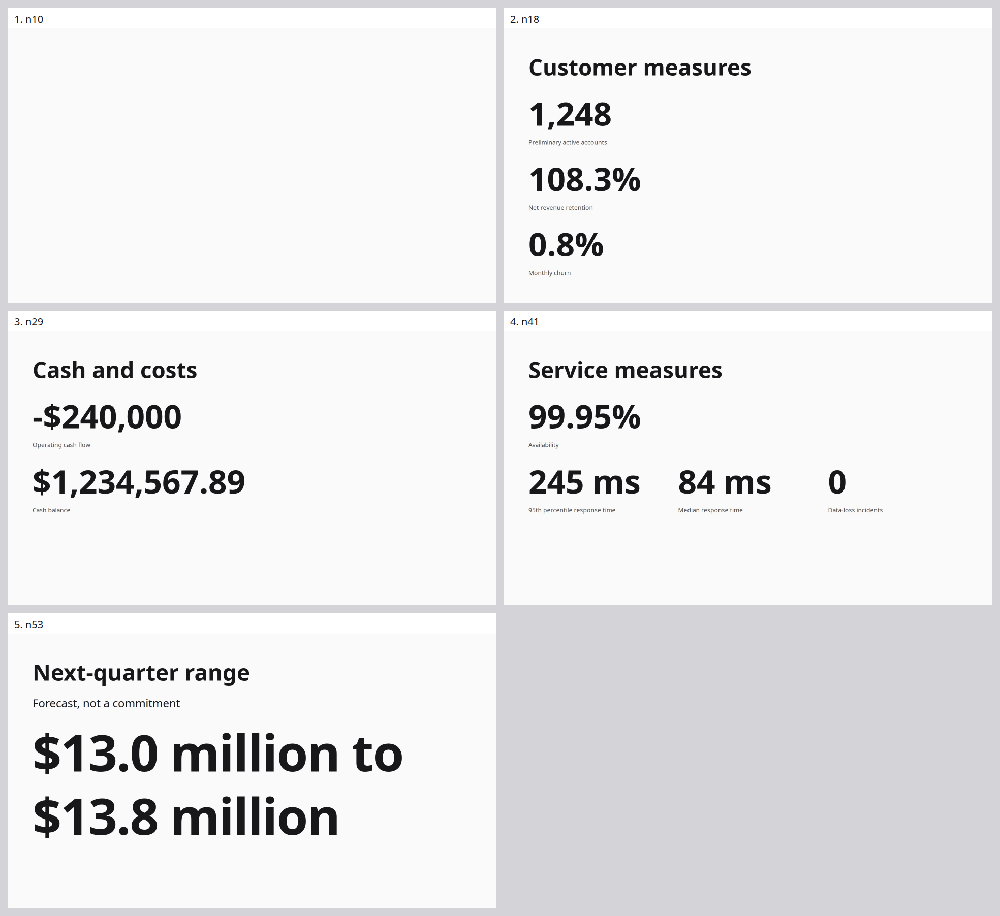
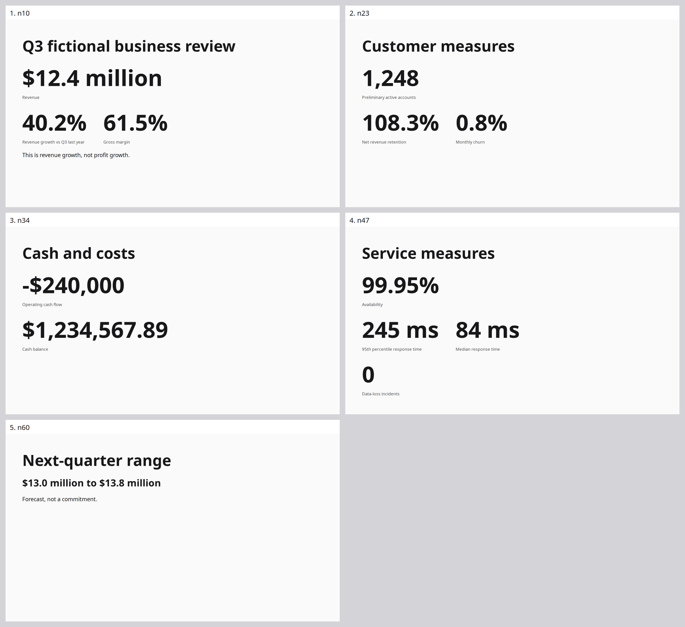
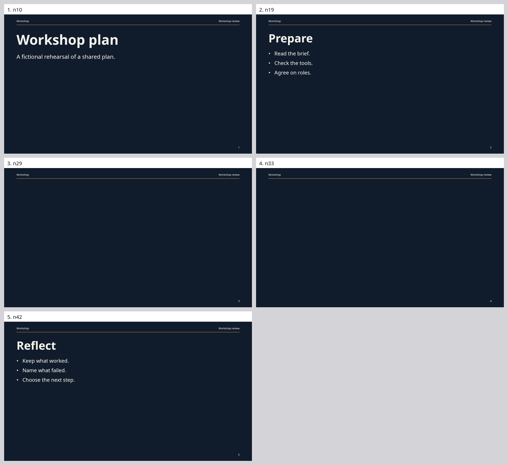
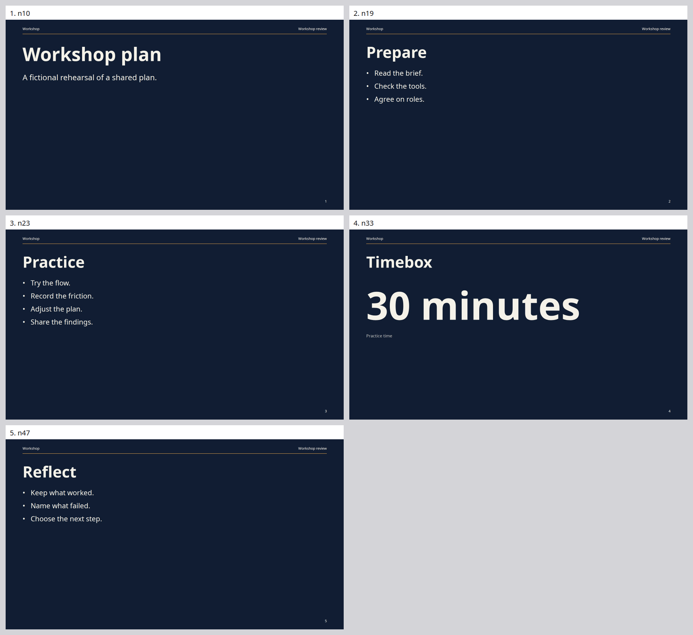
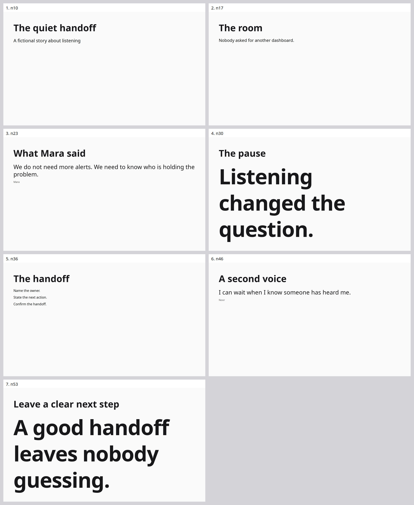
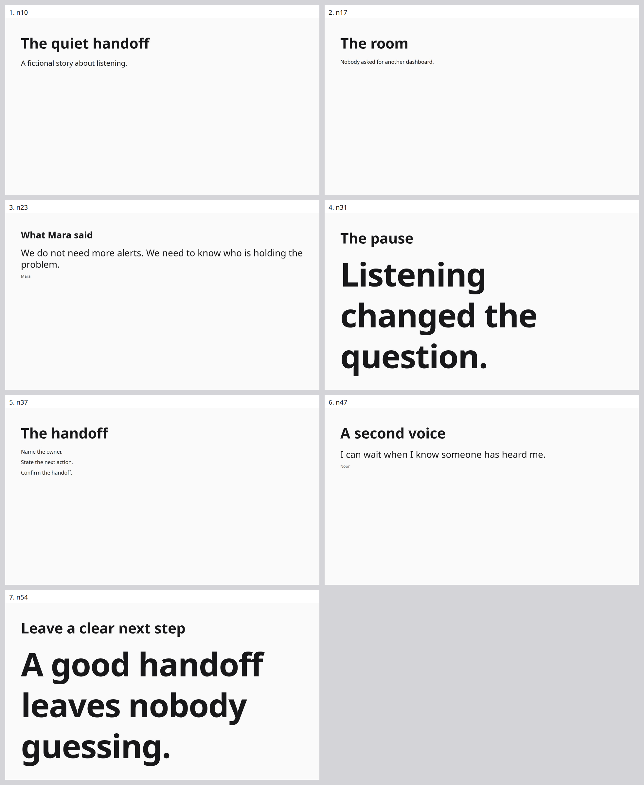
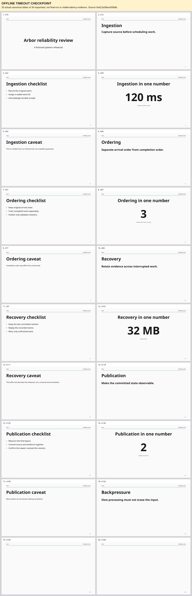
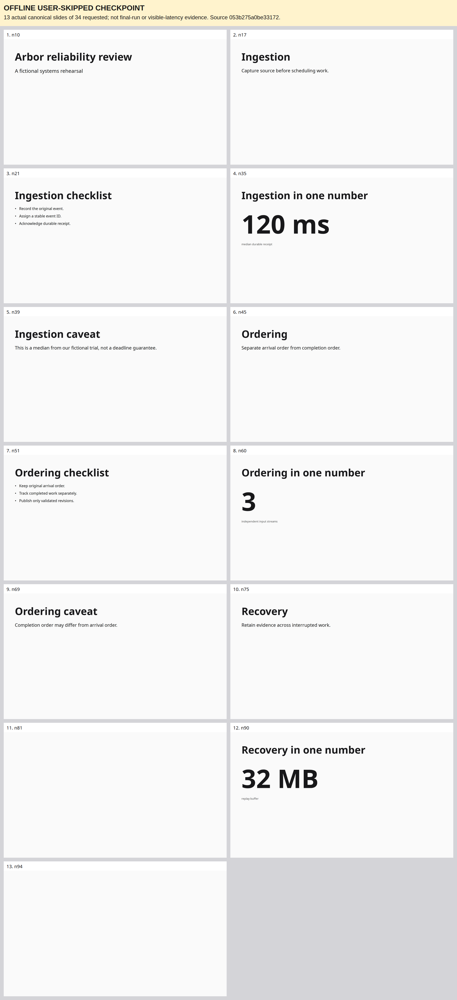

# Pass 2 — broader talk coverage (PASS CLOSED; QUALIFICATION UNFINISHED)

Date: 2026-10-31. This pass measures the other four original timed talks against the same frozen pair used at the end of [Pass 1](../pass-01/README.md). Numbers-business, style-switch and narrative-keynote completed both versions. Long-technical baseline timed out; the user explicitly skipped its running candidate. This bounded pass is now closed: six completed trials, one timeout and one user-skipped trial. Five-talk qualification remains unfinished.

## Conditions and evidence

The baseline is `734d84a7be9b4924e0c4ee0213d598cc2564826a`; the candidate is `7aee9be498d77435d2cca642f4f4000143e364a0`. Eight runs were scheduled serially, one repetition per version/talk, at pace 1. The candidate combines stable utterance-ID delegation, actual source for Slow decisions and pending-rename routing support; this is not a single-change ablation. No existing fixture assertions or raw recordings are changed during the batch.

Original evidence is under `.artifacts/runs/headless-round-05-breadth/{baseline,candidate}/{talk}/1/execution/slide-generation/.artifacts/run/`. The parent `batch.json` records completed trials and the baseline timeout; `user-stop-request.json` separately records the candidate cancellation because interruption was initially recorded as running and then failed by the batch controller; the user-stop record is authoritative for the cancellation reason. Each completed run retains its exact source, provider cassette, operations, model/tool records, viewer timeline/video, audit and metrics. The completed-trial screenshots below are byte-for-byte copies of each run's `final/deck-contact-sheet.png`, with every live slide in canonical order. They combine existing final captures; they do not establish what was visible during the talk. Any separately labeled offline checkpoint image is a reconstruction from saved partial source, not a normal final export or live audience frame.

The six completed manifests share runner SHA-256 `9d30b680776027b1dad70dc436d18da65009ec4b8ccd06c0988fd7df352c9051`, evaluator `f46b9b61a072886ee2f9a1999039c1eb6ea2da2ca3557e634e868d0295e725aa` and observer `c74bda2333568a28479ef40a855073c4f8e01d12d565a7dff14f1ab1769963ef`. Harness source is `a65a1a5` for the first three runs and `23bd09b` for the style candidate and both narrative runs; both style runs and both narrative runs mark their surrounding workspace dirty while retaining these same measured harness hashes. Frozen generator sources remain separate from the common observer/evaluator. The formal completed-talk comparison is recorded under `.artifacts/comparisons/pass-02-completed-talks/`; its findings are summarized below.

## Completed measurements

| Talk / version | Calls | Input tokens | Output tokens | Retained inputs | Visible success / expected | Visible misses, including manual | Final slides |
|---|---:|---:|---:|---:|---:|---:|---:|
| numbers-business baseline | 82 | 929,597 | 2,857 | 19/19 | 6/26 (23.1%) | 20 | 5 |
| numbers-business candidate | 79 | 1,020,211 | 3,061 | 19/19 | 8/26 (30.8%) | 18 | 5 |
| style-switch baseline | 77 | 901,113 | 2,949 | 15/15 | 3/21 (14.3%) | 18 | 5 |
| style-switch candidate | 86 | 1,514,495 | 3,427 | 15/15 | 2/21 (9.5%) | 19 | 5 |
| narrative-keynote baseline | 59 | 716,123 | 1,424 | 10/10 | 8/12 (66.7%) | 4 | 7 |
| narrative-keynote candidate | 63 | 911,741 | 1,546 | 10/10 | 7/12 (58.3%) | 5 | 7 |

All six completed runs settled, recorded completely and passed final mandatory readiness and exact canonical input retention. Readiness does not establish content correctness. Each style run additionally has one original timed readiness miss because the audit selects the later final-export timestamp. The candidate separately records a successful exact-final-revision `presentation_readiness` tool result at 111,968.250 ms, inside its 118,190.100 ms deadline; the current evaluator ignores that earlier proof and uses the 121,799.506 ms final export. This evidence-selection limitation does not justify rewriting the original score or inferring an earlier baseline proof. See the [style-switch case](cases/style-switch.md) and [evaluator follow-up](fix-cards.md). Cost is unknown.

| Talk / version | Successful visible p50 ms | p90 ms | p95 ms | Observed max ms |
|---|---:|---:|---:|---:|
| numbers-business baseline | 11,004.207 | 15,337.956 | 15,337.956 | 15,337.956 |
| numbers-business candidate | 9,215.698 | 22,251.784 | 22,251.784 | 22,251.784 |
| style-switch baseline | 5,392.323 | 8,761.739 | 8,761.739 | 8,761.739 |
| style-switch candidate | 5,488.769 | 7,276.481 | 7,276.481 | 7,276.481 |
| narrative-keynote baseline | 13,200.144 | 20,807.300 | 20,807.300 | 20,807.300 |
| narrative-keynote candidate | 15,294.182 | 24,089.713 | 24,089.713 | 24,089.713 |

Latencies start at actual utterance delivery end and are rounded here to three decimals; full precision remains in the run reports. These distributions include successful observations only. Misses remain in the coverage denominator and have no invented zero latency. Different successful expectation sets, unresolved manual checks and one repetition prevent a speed, quality or cost improvement claim.

## Numbers-business: completed pair

Baseline final deck:

Candidate final deck:

The baseline's overview is blank. The candidate's final overview visibly includes revenue `$12.4 million`, corrected growth `40.2%`, the Q3 comparison, gross margin `61.5%` and the revenue-not-profit distinction. Both final decks retain customer measures, negative cash flow, exact cash balance, service figures and the forecast range with its noncommitment qualifier. Neither final cash slide retains the removed cloud cost.

That final correctness does not establish timely display. The candidate's last settled customer frame still lacks monthly churn and the preliminary qualifier; those enter canonical source only after leaving that slide. The baseline displayed both. The [individual numbers-business case](cases/numbers-business.md) records exact frame/commit times, snapshot misuse, stale insertion anchors and baseline glyph-coverage validation refusals. The latter are recorded browser-measurement failures; clipping is a hypothesis awaiting reproduction, not a permission issue or established diagnosis.

Visually, both decks rely mostly on plain dark type and Stats on an almost-white background. The candidate's overview uses a clearer metric row; its service slide wraps the zero-incident metric beneath the response measures. The baseline forecast dominates its slide with a large two-line range; the candidate uses a compact range under the title with considerable unused space. The images show readable hierarchy in populated slides, but little evidence of richer composition, decoration or icon use. This review does not qualify design quality.

The original audit outcomes remain baseline 6 pass / 13 fail / 7 manual and candidate 8 pass / 11 fail / 7 manual. Exact whole-string and Stat-label matching creates false misses for expanded labels and a combined forecast range; the linked case distinguishes these from actual absent or late content. No score is silently upgraded from manual inspection or final source.

## Style-switch: completed pair

Baseline final deck:

The final baseline consistently shows dark navy surfaces, light text, amber frame rules, Workshop / Workshop review labels and page numbers across all five slides. Opening, Prepare and Reflect have visible content; Practice and Timebox contain only the shared frame, with blank bodies. The opening title is larger than the list-slide titles, and Prepare/Reflect have a similar visible list composition. These final-image observations do not prove reuse of a single design, timely theme propagation, frame transitions or motion.

The baseline audit records utterance `style-switch-009` targeting Practice `n29` but routing to Timebox `n33`. That is a recorded wrong target; it must remain visible in evaluation rather than rebinding the expected slide. The final Reflect list is present even though its automatic visible expectation missed, so timeline evidence must be reviewed before treating that miss as missing final content. Original outcomes are 3 pass / 5 fail / 14 manual, including the separate timed readiness miss.

Candidate final deck:

The candidate's final deck visibly fills all five slides. Practice contains all four requested points, including Share the findings; Timebox shows corrected `30 minutes` with Practice time. All slides use the latest navy/light/amber palette and Workshop review frame. The same plain left-aligned list family dominates Prepare, Practice and Reflect; the large time value and opening title provide some scale variation. This is a visible final-content improvement over the baseline's two blank bodies, with limited compositional variety.

The candidate nevertheless scores only 2/21 visible successes, against the baseline's 3/21. Its original audit totals are 2 pass / 6 fail / 14 manual, including the timed readiness miss. It also routes `style-switch-009` to Timebox `n33` instead of Practice `n23`. The exact final source and selected-slide timeline must be reviewed separately: final populated slides cannot retroactively turn offscreen or earlier incorrect content into visible success. No manual or semantic finding has been converted into an automatic pass.

## Narrative-keynote: completed pair

Baseline final deck:

Candidate final deck:

Both have all seven expected slides with the requested narrative content. Mara's quotation remains exactly “We do not need more alerts. We need to know who is holding the problem.” and Noor's exactly “I can wait when I know someone has heard me.”, with correct attribution in dedicated Quote nodes. No survey, percentage or customer count appears in either final deck. These are final-source/image observations; they do not replace the remaining history and no-unrequested-change review.

The final handoff source in both versions assigns build 1 to Name the owner, build 2 to State the next action and build 3 to Confirm the handoff. This establishes the encoded grouping and order, not audience playback: the final exports show all three phrases, and the build-order audit remains manual. No motion claim follows from these sheets.

Both use plain near-black text on an almost-white background. The pause and closing statements use very large, three-line display text; the other slides use small left-aligned content and extensive empty space. This produces scale contrast and sparse composition, but little layout or decorative variety. The candidate reduces the Mara slide heading relative to the baseline; quotation content remains intact. Neither final sheet shows obvious overlap or clipping at this review scale, and final mandatory checks passed; this is not a complete design qualification.

Original audit outcomes are baseline 8 pass / 0 fail / 4 manual and candidate 7 pass / 1 fail / 4 manual. The candidate's `narrative-keynote-a001` fails exact whole-string matching because the visible subtitle is `A fictional story about listening.` with a terminal period, while the fixture expects the same words without that period. Candidate `viewer/frame-000006.png` visibly contains both title and subtitle. Record this as a matching limitation rather than missing words; preserve the original score. Both quote-exact expectations pass on recorded viewer evidence. The four manual observations cover sparse design, build order and invented-number prevention. Neither run records a wrong-target route.

## Long-technical: timeout and user-skipped candidate

The baseline reached its driver drain deadline at 485,844.222 ms with recording incomplete, then the outer process watchdog timed it out. Its last saved canonical state contains 20 live slides and 34 exact Prompts, against 34 requested slides and 58 utterances. All 58 original inputs have durable outer receipts, but 24 had not reached canonical Prompt/actor delivery in that saved state. These are different retention boundaries; an outer receipt is not a completed canonical edit. The [long-technical case](cases/long-technical.md) records the growing routing and validation backlog and the timestamps behind this diagnosis.

The candidate was stopped on the user's explicit request to skip this example, recorded at `2026-10-31T07:15:41.785568+00:00` in `user-stop-request.json` with classification `user-skipped`. It is not a second natural timeout and must not be treated as a completed paired sample. Neither long run has normal final metrics, audit, provider-usage totals or final readiness exports; no coverage score, latency percentile, total usage or success is invented for them.

### Offline saved-state images — not normal final exports

After all live trials stopped, the saved canonical sources were rendered with their respective frozen renderer and browser pipeline into new directories outside the original runs. Both offline checks completed with no findings or Pending nodes, using zero API calls and zero attempted network requests. This verifies only the saved partial source; it cannot supply missing final-run readiness, faithful completion, complete recordings or earlier audience evidence. The capture process verified all original files it read remained unchanged (61 baseline files and 46 candidate files).

| Offline checkpoint | Saved slides / requested | Durable outer inputs | Exact canonical Prompts | Generated UTC |
|---|---:|---:|---:|---|
| Baseline timeout | 20/34 | 58/58 | 34/58 | 2026-10-31 07:16:31.663 |
| Candidate user-skipped | 13/34 | 43/58 | 22/58 | 2026-10-31 07:16:47.466 |

Baseline saved source SHA-256 is `0ed12a36ace058db074bb5a05216930714bb9a5935b6a929120db36a605a804b`; candidate is `053b275a0be33172a42020540567f0d53f7d0048dcc75479a7a8bcc617ddb0d9`. Reports, exact checkpoint sources, retention checks, provenance, individual captures and validation reports remain under `.artifacts/review/pass02-timeout-baseline/` and `.artifacts/review/pass02-user-skipped-candidate/`. The two PNGs below are unchanged copies of those directories' labeled `checkpoint-deck.png` files. They include every actual saved slide, without inventing the missing requested slides.

The baseline checkpoint has a consistent Arbor / Reliability review frame, page numbers and thin teal rule. Section, checklist, metric and caveat layouts repeat; the opening and large numeric values use centered compositions. The last two saved slides have only frame content. Visible metrics include `120 ms`, `3`, `32 MB` and `2`, with accompanying labels and separate caveat slides. This image shows a partial deck with some reusable structure, not a completed 34-slide result.

The candidate checkpoint uses plain left-aligned dark type on white with no visible shared frame. Saved slides 11 and 13 have blank bodies. Its opening, section text, checklists and three metric slides show less compositional variation than the baseline checkpoint. The runs stopped at different points for different reasons, so this visual comparison is descriptive only; it is not a matched final quality or performance result. Neither sheet establishes animation or build playback.

## Formal comparison and stopping boundary

The recorded comparison under `.artifacts/comparisons/pass-02-completed-talks/` includes the completed numbers, style and narrative pairs plus the existing edit-heavy pair from [Pass 1 stage 4](../pass-01/stages/04/README.md). Reusing edit-heavy evidence does not count as another repetition. All four pair rows verify matching evaluator/observer instrumentation, but their successful expectation sets differ and incomplete/manual coverage remains. Every p50 change is therefore `not comparable`; `measurementSetComplete` and `qualificationComplete` are both false. The comparison supports no speed improvement claim. Costs remain unknown.

## Unfinished qualification

The user has bounded work to closing this current pass and wrapping up; no additional live batch or retry is planned. Repeated five-talk qualification, animation/video review, audience build coverage and broader design/semantic review remain unfinished. The separate [quality fixtures](../../../fixtures/quality/README.md) add mixed layouts, theming, decoration and motion; they are separate from this unchanged four-talk breadth batch and remain authored and schema-validated only, without live results.

This overview was prepared from recorded files and existing images without API calls, browser probes or tests during live timing. The separately labeled offline checkpoint captures were generated only after live trials stopped. Original artifacts remain unchanged. Follow [current continuation](../../continuation/README.md) for the saved stopping checkpoint.

## Offline verification and wrap-up

The user requested finishing this pass and wrapping up, then explicitly skipped the final live example. No new live
batch or proposed runtime fix was started. The three expanded quality fixtures are authored/schema-validated only.

| Completed recording | Canonical transaction replay | Evidence |
|---|---|---|
| numbers baseline | Failed closed: actual tool error differs from recorded error | `.artifacts/replays/pass-02/baseline-numbers-business/failure.json` |
| numbers candidate | Failed closed: unseen or wrong-scope read | `.artifacts/replays/pass-02/candidate-numbers-business/failure.json` |
| style baseline | Failed closed: unseen or wrong-scope read | `.artifacts/replays/pass-02/baseline-style-switch/failure.json` |
| style candidate | Passed: 55 steps, exact final source, real readiness | `.artifacts/replays/pass-02/candidate-style-switch/report.json` |
| narrative baseline | Passed: 33 steps, exact final source, real readiness | `.artifacts/replays/pass-02/baseline-narrative-keynote/report.json` |
| narrative candidate | Passed: 32 steps, exact final source, real readiness | `.artifacts/replays/pass-02/candidate-narrative-keynote/report.json` |

All six replay attempts disabled live network fallback and used actual Chromium. Three passed and three refused; the
recordings and mapper were not repaired to force success. Wrong-scope calls are present in the original live traces;
current replay handling of such recorded refusals remains a limitation. The baseline numbers tool-error mismatch needs
separate diagnosis. These results are transaction replay only, not full actor replay or latency measurements.

The timeout and user-skipped long traces lack authoritative `operations.json` and `commits.json` exports. Their standard
canonical replays cannot honestly run. The separate offline checkpoint captures instead verify the saved source and
actual frozen renderer dependencies, without claiming a completed trace, successful talk, or live visible timing.

Final TypeScript checking and all **318 tests passed**, recorded in `.artifacts/environment/pass-02-final-suite.tap`; quality-fixture schema, controller
creation counts and evaluator-metadata isolation are recorded in `.artifacts/environment/quality-fixture-validation.json`.
See the [current continuation](../../continuation/README.md) for the final checkpoint and remaining boundaries. Proposed
[diagnostic fixes](fix-cards.md), expanded live quality runs, broad actor replay and audience/build validation remain
future work. O04 editing focus awaits the user's answer; no routing behavior was changed in this wrap-up.
